# Build Editor 1.0 guide

Unreal Engine 5.4 · Windows 64-bit

## Quick Start

Start in your own project with the matching Build Editor package installed. The supplied setup works in a Blueprint-only game.

> [!NOTE]

> A source-only installation needs Unreal's supported C++ build tools to compile the plugin. You do not need to write game C++ for the steps below.

1. **Enable the plugin.** Open **Edit > Plugins**, search for **Build Editor**, and enable its checkbox. Restart Unreal if requested.

   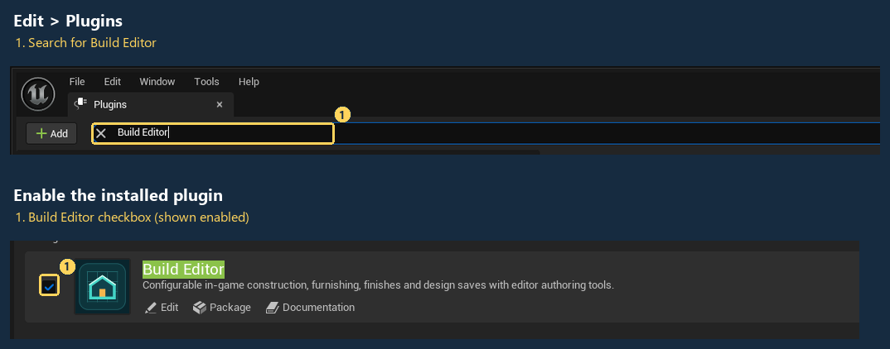

2. **Create a lit level.** Choose **File > New Level > Basic**. Keep the lighting actors.

   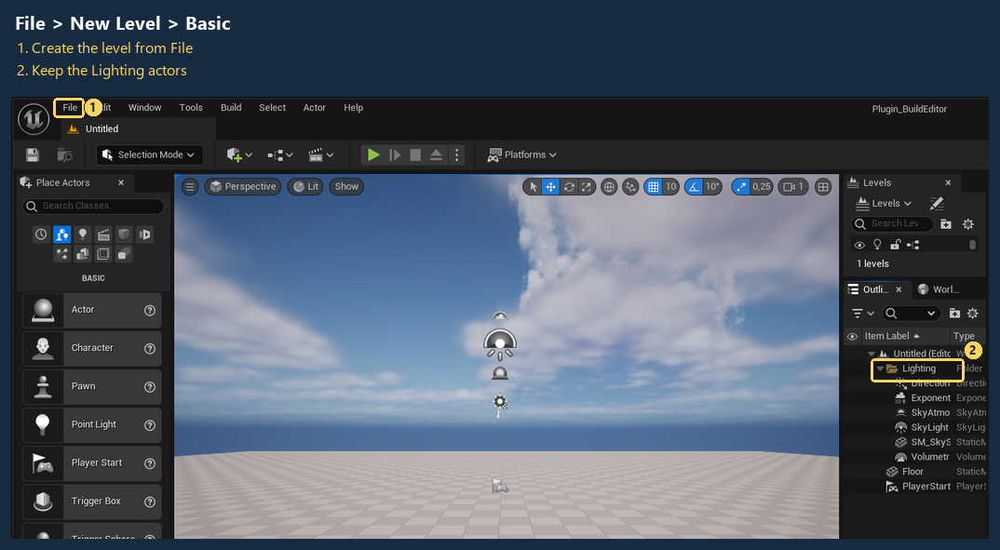

3. **Open the setup tools.** Choose **Tools > Build Editor**, then **Setup** in the sidebar.

   

4. **Connect the supplied controls.** Click **Use Build Editor GameMode**. The level status changes to **Build Editor Game Mode**; this supplies the camera, controls and building interface.

   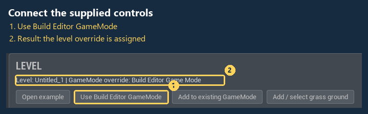

5. **Start Play.** Click Unreal's green **Play** button. You should see **Build mode**, the Basic level's ground and the built-in item palette.

   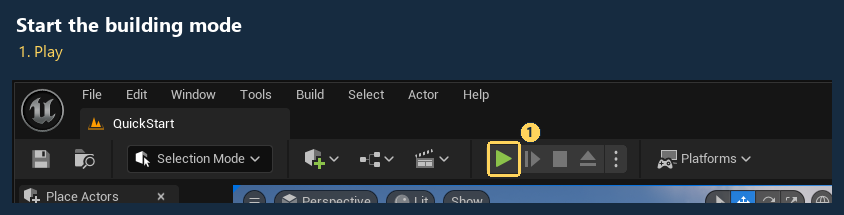

6. **Choose Draw room.** Click **Draw room** in the lower-left tools.

   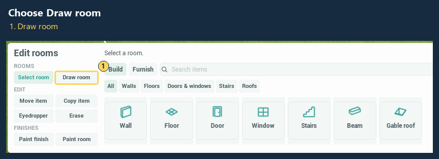

7. **Draw your first room.** Press and hold on the ground, drag out a rectangle, then release. A floor and surrounding walls appear. **Undo** removes the room.

   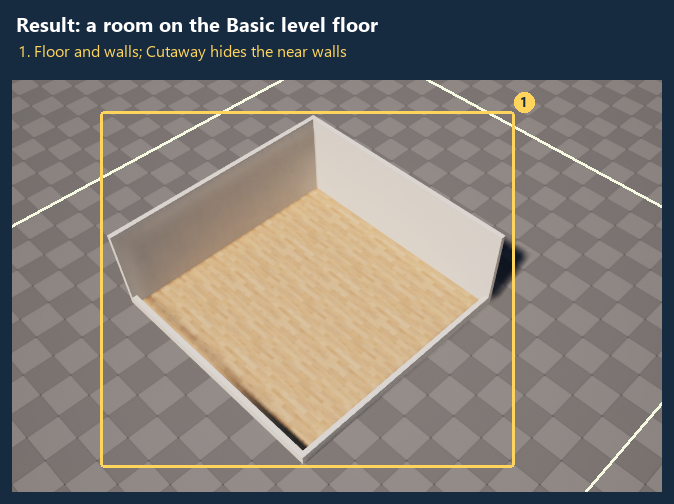

> [!TIP]

> Stop Play before editing settings. The built-in catalog works immediately; create a custom catalog only when you want to change the items. If you use a two-click profile instead of the default drag controls, click the start and end corners.

**No ground or dark scene?** Keep the Basic level's lights. A completely Empty level needs lighting. If your project uses Lumen software tracing, enable **Generate Mesh Distance Fields** in Project Settings and restart after changing it.

## Contents

- [Quick Start](#quick-start)

- [Work in the editor](#work-in-the-editor)

- [Keep your existing GameMode](#keep-your-existing-gamemode)

- [Change the camera](#change-the-camera)

- [Customize the interface and build interactions](#customize-the-interface-and-build-interactions)

- [Native component and host integration](#start-with-the-native-component)

- [Shared multiplayer building](#shared-multiplayer-building)

- [Build area, ground and floors](#build-area-ground-and-floors)

- [Floors and stair connections](#floors-and-stair-connections)

- [Input and room operations](#route-input-from-your-project)

- [Room resizing](#resize-a-room)

- [Catalogs and material finishes](#make-a-catalog)

- [Resize windows and doors](#resize-windows-and-doors)

- [Default controls](#default-controls)

- [Gamepad controls](#gamepad-controls)

- [Game packaging](#package-your-game)

- [Saves and migration](#schematic-saves)

- [Automatic draft recovery](#automatic-draft-recovery)

- [Furniture and support surfaces](#furniture-and-support-surfaces)

- [Roofs and camera](#roofs-and-building-views)

- [Walking visitor customization](#customize-the-walking-visitor)

- [Included top-down camera](#included-top-down-camera)

- [Performance and edit reliability](#performance-and-edit-reliability)

- [Reusable profiles and scene settings](#reusable-build-profiles-and-scene-settings)

- [Scene music and ambience](#scene-music-and-ambience)

- [Support](#support)

## Work in the editor

Use the sidebar to change tasks. Hover over a control for help. **Show guidance** or <kbd>F1</kbd> reveals extra instructions; they stay hidden by default.

| Page | What to do there |

|---|---|

| **Setup** | Connect the level, choose its catalog and open the active settings |

| **Decorations** | Create a catalog, edit items and preview their art and finishes |

| **Profiles** | Create, duplicate, save and assign reusable settings |

| **Camera** | Change the active starting view, zoom, tilt and movement speeds |

| **Interface** | Change appearance, layout and replacement widgets |

| **Project defaults** | Edit this project's fallback settings |

| **Selected actor** | Inspect settings on a selected Build Editor actor, component or Blueprint |

| **Validation** | Run checks; click an item error to open its inspector |

### Set the grid and building area

1. In **Setup**, click **Edit Construction**.

2. Set **Grid Size** and **Floor Height**. To limit the lot, enable **Use Build Area Bounds**, then set **Build Area Min Cell / Max Cell**.

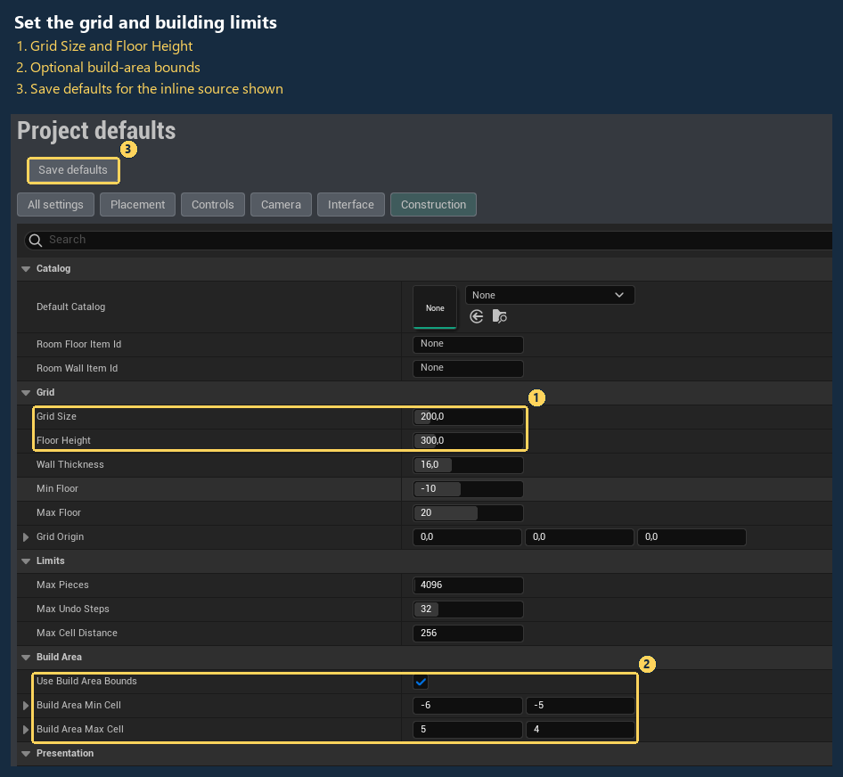

3. Save the settings source: **Save defaults** for inline project settings, or **Save profile** for a profile. Start a new Play session to use the changes.

**Ground size is visual.** It does not change the permitted building area.

### Keep your existing GameMode

1. Open your level and choose **Setup > Add to existing GameMode**.

2. Choose a name and folder for the new Blueprint. The tool creates a child of the level's active GameMode and assigns it to this level.

3. Press **Play**. Save the child and level when you want to keep the setup.

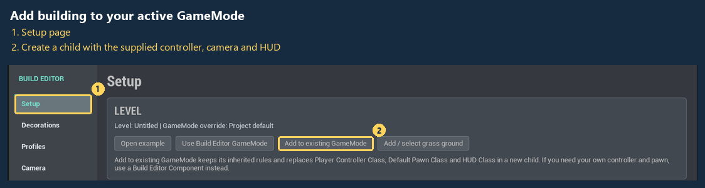

The child inherits your GameMode's rules and other defaults. Your original asset stays unchanged. The level override takes priority; otherwise the tool uses the map-prefix GameMode or project default. **Undo** restores the previous level override; the new Blueprint remains in the Content Browser.

> [!IMPORTANT]

> This quick setup uses Build Editor's **Player Controller Class**, **Default Pawn Class** and **HUD Class** in the child. Parent logic that expects your old controller, pawn or HUD needs adapting. To keep all three, follow [Connect an existing game](#connect-an-existing-game) and supply your own input and interface.

For shared building, use the supplied **Build Editor Player Controller** or a subclass. The setup also adds one **Build Editor Shared Session** actor to the level; see [Shared multiplayer building](#shared-multiplayer-building).

The child uses **Camera Pawn Class** selected at creation, or the built-in camera when none is assigned. To change the pawn class later, open the child's **Class Defaults > Default Pawn Class**. The supplied camera and controller read the active profile at Play start while **Use Project Settings** is enabled.

### Change the camera

1. Open **Camera** in the sidebar. **Editing** identifies the active level profile, project profile or inline defaults.

2. Expand **Camera** for starting distance, angles, target position and zoom/tilt limits. Expand **Controls** for pan, orbit, zoom and gamepad pointer speeds.

3. Click **Save camera settings**, then start Play again.

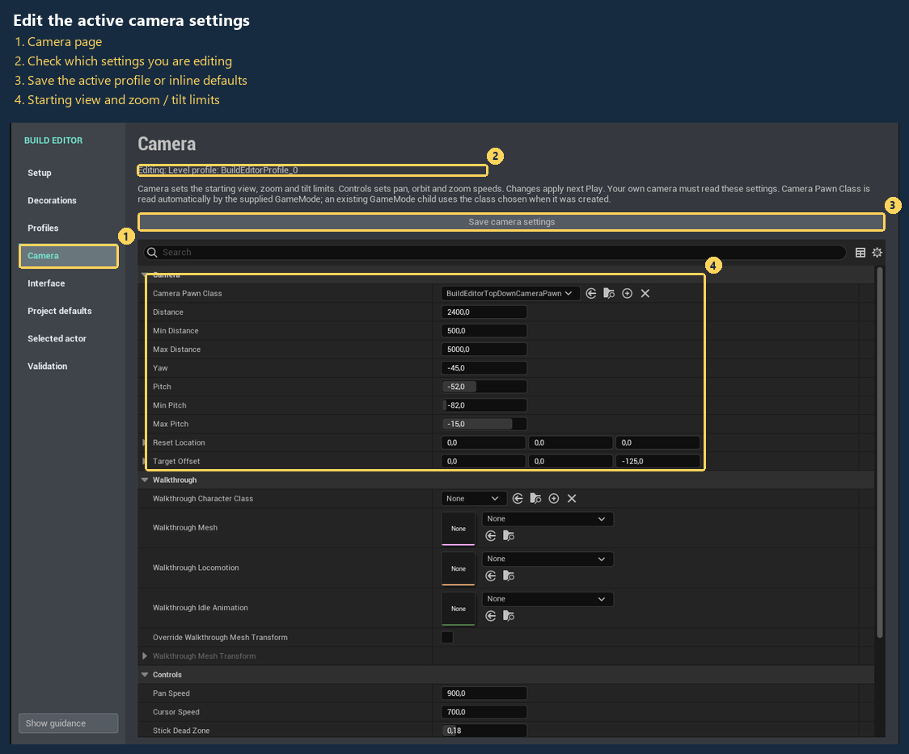

This page edits the settings used by the supplied camera and controller. Looking at another profile in **Profiles** does not change its target. Your own camera must read these settings to use them. Extra smoothing, collision and pan-boundary options for the included camera are available in a camera pawn Blueprint's **Class Defaults**; see [Included top-down camera](#included-top-down-camera).

### Find placed pieces in the Outliner

Build Editor groups pieces under **Build Editor > Floor 0 > Walls**, **Floors**, **Objects** and the other piece types. Each floor has its own folders, including negative floors for basements. **Generated** holds the combined wall mesh, **Previews** holds temporary ghosts, and **Settings** holds new level profile sources. Optional grass ground goes in **Environment**.

Folders update on placement, loading, undo/redo and floor changes. They organize the editor Outliner without attaching actors or changing their transforms. Pieces placed during Play still follow Unreal's normal Play-session lifetime; folders do not save them into the level.

### Customize the item palette

1. Open **Decorations > New catalog**. Choose a folder in your project's Content and create the catalog.

2. Select an item. Change its **Name**, **Group**, art or placement settings in the inspector. **Duplicate** makes a copy with a new ID. Expand **Quick configure** for door, window, table/shelf and tabletop-prop starting settings.

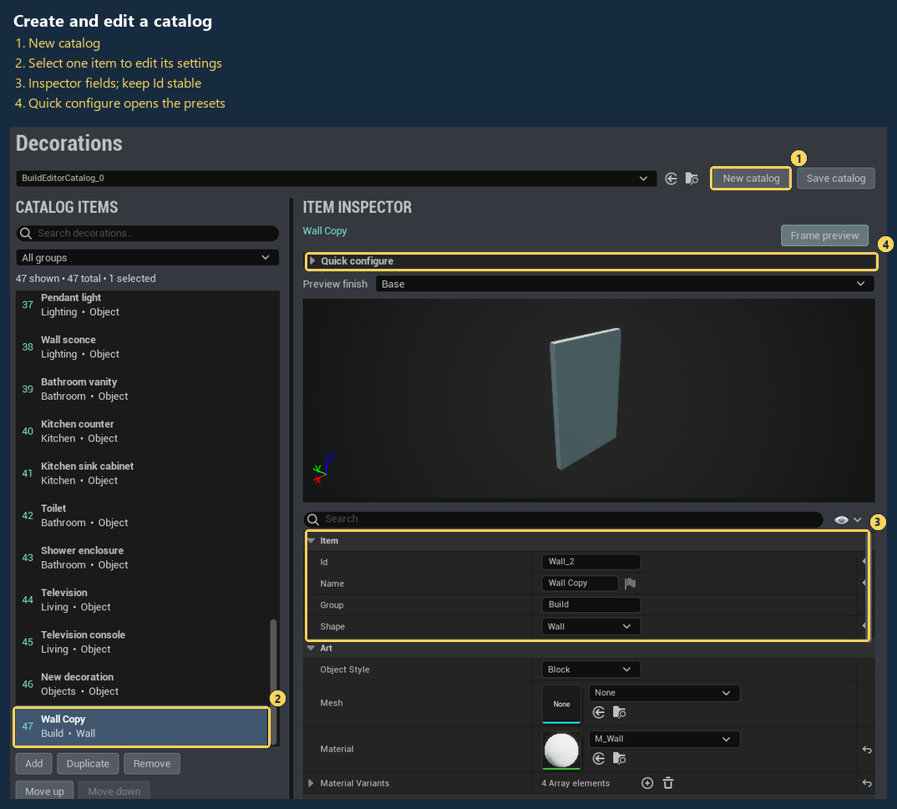

3. Click **Save catalog**. Fix any errors reported by **Validation**.

4. Return to **Setup > Use open catalog**. Save the settings source shown there: **Save defaults** or **Profiles > Save profile**. Start Play again.

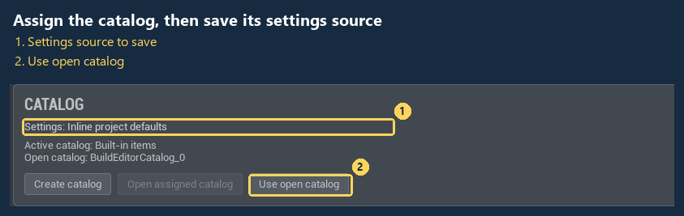

> [!IMPORTANT]

> Rename an item with **Name**. Its **Id** identifies it in saved builds; changing or removing the ID can prevent those pieces from loading. Save the catalog and its assignment separately.

| While editing decorations | Shortcut or control |

|---|---|

| Search name, ID, group or shape | <kbd>Ctrl</kbd>+<kbd>F</kbd>; all words must match, in any order |

| Clear text and group filters | <kbd>Esc</kbd> |

| Select several items | <kbd>Ctrl</kbd>-click or <kbd>Shift</kbd>-click |

| Duplicate the selection | **Duplicate** or <kbd>Ctrl</kbd>+<kbd>D</kbd> |

| Undo / redo | <kbd>Ctrl</kbd>+<kbd>Z</kbd> / <kbd>Ctrl</kbd>+<kbd>Y</kbd> |

| Save the open catalog | **Save catalog** or <kbd>Ctrl</kbd>+<kbd>S</kbd> |

Drag the dividers to resize the list, preview and inspector. **Preview finish** shows Base or a named **Material Variant** without changing the item. The preview shows standard geometry, meshes and materials; custom **Piece Class** behavior is tested in Play.

### Reuse settings with profiles

1. Open **Profiles**. Choose **New**, or open a supplied preset and choose **Duplicate** to make your own copy.

2. Change the relevant settings and click **Save profile**.

3. Choose **Use for level** for this level, or **Use for project** for the project default. Save the level after a level assignment; use **Project defaults > Save defaults** after a project assignment.

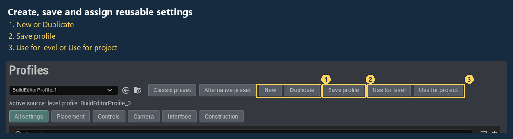

**Which settings win?** Level profile → project **Default Profile** → inline **Project defaults**. Inspecting a profile does not assign it. When inline settings are read only, **Edit project profile** opens the assigned project profile. A direct component **Catalog** overrides **Default Catalog**.

### Check before playing

Open **Validation > Run checks**. Fix catalog errors before saving; notes do not prevent saving. Click an item finding to open it. **Copy report** copies diagnostics for support.

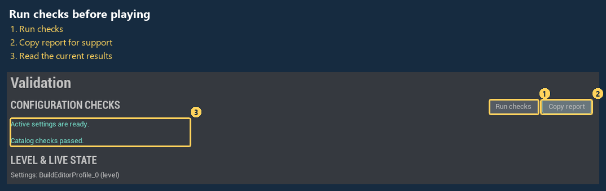

Checks cover catalogs, active settings and level configuration. They do not verify your packaged game, networking or custom gameplay.

### Use your own actors and Blueprints

The supplied camera, controller and HUD read the active settings at Play start. On a custom **Build Editor Component**, enable **Use Project Settings** to opt in. To keep local values on an actor or Blueprint, disable that switch and edit it through **Selected actor** or Unreal's Details panel. Save the level or Blueprint normally.

For your own controls and gameplay, see the [component integration reference](#start-with-the-native-component). The supplied quickstart above needs no Blueprint graph.

## Customize the interface and build interactions

### Restyle the supplied layout

1. Open **Interface > Active settings**. Check **Editing** to confirm which settings source you are changing. **Inspected profile** edits the profile selected in Profiles without assigning it.

2. Expand **Interface Style** and edit its appearance. If a theme is assigned, edit **Assigned Theme > Style** instead.

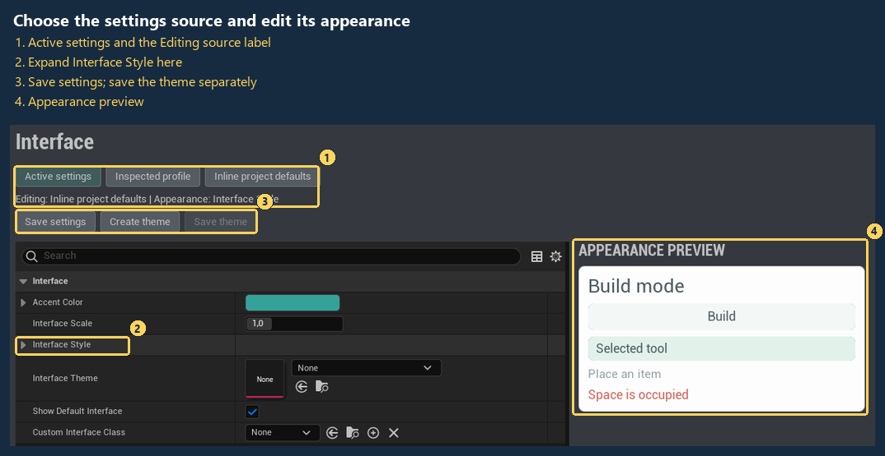

| Change | Setting |

|---|---|

| Branding | **Title**, **Subtitle**, colors and text sizes |

| Button and panel spacing | Padding, button height and corner radius |

| Bottom, left or right layout | **Browser Dock**; **Side Panel Width** for side layouts |

| Visible regions | **Sections** and **Toolbar** switches |

| Shared appearance asset | **Create theme**; an assigned theme overrides **Interface Style** |

| Button wording | **Branding > Button Labels**; use action IDs such as `Architecture`, `Furnishings`, `Walk` and `Save` |

| Scene switching | **Toolbar > Show Scene Control**; shown when the level source has multiple scenes |

3. Click **Save settings**. If you edited a theme, click **Save theme** too. These save different assets.

4. Start Play to check the complete layout. The editor preview shows appearance; replacement widgets and input need testing in Play.

> [!NOTE]

> Keep replacement controls for any actions you hide. Inline defaults are read only while **Default Profile** is assigned. Use **Active settings** to edit the active profile.

Appearance changes during Play and packaged-game references

For a live change, edit the HUD's local values with **Use Project Settings** disabled, then call **Refresh Interface**. Opted-in HUDs reread the active settings. Refresh cancels an unfinished gesture and closes dialogs; placed pieces and saved designs remain.

Themes load when the interface is created. References assigned in Build Editor settings, profiles, cooked levels and assets follow their normal cooking dependencies. Themes or widget classes chosen only dynamically need your project's asset-management rules, such as an **Always Cook** Primary Asset Label. Test the packaged game after changing those references.

### Replace one section with UMG

1. In the Content Browser, choose **Add > User Interface > Widget Blueprint** and create an ordinary widget. Open it, choose **File > Reparent Blueprint**, search for **Build Editor UI Widget** (`BuildEditorUIWidget`), and select that parent. Compile and save, then use ordinary UMG controls to design the section.

2. In **Interface Style > Widget Replacements**, or the assigned theme's **Style**, assign **Toolbar Widget Class**, **Tools Widget Class**, **Catalog Widget Class** or **Status Widget Class**. Keep **Show Default Interface** and that section's visibility enabled. Tools and Status are inside the catalog panel and also require **Show Catalog**. The remaining supplied sections stay available; an empty class uses the supplied section.

3. Populate controls in **On Build Editor Ready**. Call **Get Interface Style**, **Get Interface Accent Color** and **Get Interface Scale** for the shared presentation. These are initialization-time appearance values; call the HUD's **Refresh Interface** after changing the source.

4. Handle **On Build Editor State Changed** to update selection, tools, levels, room bounds, drawing, painting, preview validity, feedback and Undo/Redo availability. Notifications occur after initialization and at most once per controller frame when observable state changes. They do not copy the catalog or placed records. Call **Get Interface State** for an immediate read after your own action, and use the existing controller/component nodes for actions.

Regional widgets inherit the supplied panel's responsive scale; author their dimensions in the style's unscaled Slate units. Do not multiply their render scale again by **Get Interface Scale**. A complete UMG replacement owns its layout and can use the configured scale with the project's UMG DPI policy.

Nested widgets with the same parent class connect automatically when constructed with the local Build Editor controller as their owning player. Each widget owns its modal/text-input flags: clearing one does not release another widget's blocker. Shutdown, destruction and HUD refresh release owned contexts and subscriptions. Manually hosted widgets can also call **Initialize Build Editor** and **Shutdown Build Editor** explicitly.

A failed section class uses the supplied controls for that section and records a diagnostic. The supplied local save/load dialog remains available for regional replacements. A complete layout replacement can implement its own library as described below. Section replacements appear in build mode; use a whole-interface widget when you need custom controls across building and gameplay modes.

### Replace the layout with UMG

1. Create and reparent a **Widget Blueprint** to **Build Editor UI Widget** as described above. Design your own panels, catalog cards and controls using ordinary UMG.

2. In **Interface**, choose the intended settings source and assign the widget as **Custom Interface Class**. Disable **Show Default Interface** for a complete replacement, or leave it enabled to add a custom overlay to the supplied layout. Save that settings source.

3. Use **On Build Editor Ready** to populate controls and **On Build Editor State Changed** for presentation updates. **Build Controller** exposes painting, camera, recovery and gesture operations; **Get Build Editor Component** exposes catalog items, selection, construction, rooms, history and saves. **On Build Editor Changed** receives the complete committed transaction. Keep further edits outside that callback and defer them until it finishes.

4. Handle **On Build Editor Mode Changed** to show building or gameplay controls. The custom widget remains available in view mode so it can offer a return button. Bind **Set Build Mode Enabled** to your own mode control.

5. On custom dialogs, call **Set World Input Blocked(true)** and restore it to false when closing. For editable text, call **Set Text Input Active** on focus changes. These calls cancel unfinished gestures and prevent build/camera shortcuts from affecting the world while your UI owns input. Regular interactive UMG controls are excluded by Slate hit testing; keep empty fullscreen panels **Not Hit Testable (Self Only)** so empty space allows world input.

6. With the supplied layout disabled, **On Build Editor Library Requested** receives Save/Load requests, including controller shortcuts. Implement your library using **Build Editor Library** nodes, the controller's **Library Id** and **Save User Index**, and explicit overwrite/delete confirmation. **On Build Editor Library Closed** closes your UI when the mode or HUD changes.

The HUD connects and disconnects widget event bindings when it is refreshed or removed. A manually hosted widget can call **Initialize Build Editor** and **Shutdown Build Editor** for the same lifecycle. Defer **Refresh Interface** until ready, initial mode and library-close callbacks finish; recursive refresh is rejected. A configured widget class that cannot load or initialize uses the supplied-interface fallback. An empty custom class with **Show Default Interface** disabled intentionally creates no supplied UI; world feedback and component APIs remain available.

### Choose the drawing method

Use **Setup > Edit Placement** to edit the active settings' **Interaction** values, or disable **Use Project Settings** on a controller Blueprint and edit its local **Interaction** values.

| Tool | Choices | What the second point controls |

|---|---|---|

| Walls | Press/drag/release or click start/click end | Wall-run direction and length |

| Beams | Press/drag/release or click start/click end | Beam-run direction and length |

| Floors | Press/drag/release or click start/click end | Filled rectangle corner |

| Draw room | Press/drag/release or click start/click end | Room rectangle corner |

| Roofs | Press/drag/release or click start/click end | Roof footprint corner |

| Stairs | Place fixed flight or click start/aim direction | Closest grid heading; run and height remain configured |

For a held gesture, press the first point and move while holding to see the candidate geometry, then release to commit. For two-click drawing, click the start, move with the button released to preview, then click the end. **Escape** cancels. Tool/floor/mode changes and lost input focus cancel unfinished work. The interface's next-step guidance reflects the selected policy.

Straight stair direction selection is not an arbitrary connection between two heights or a spline stair builder. It turns the configured flight toward the second position and climbs exactly one **Floor Height**. Choose run, width, riser size and headroom in the catalog; turning flights and character traversal require additional host logic.

### Route your own input

Build Editor's input scope is **mouse and keyboard**, plus **gamepad**. A complete touch control scheme is outside this version's scope. The pointer APIs remain available for a host that provides its own touch interface.

The supplied controller exposes **Handle Pointer Down**, **Update Pointer Position** and **Handle Pointer Up** in viewport pixel coordinates for host input routing. When using these APIs, supply movement updates while holding or while waiting for the second click; the supplied mouse/touch input owner does this automatically. Avoid dispatching the same event through both your input mapping and the default controller handler.

Paint finish first selects a target and swatch, then held pointer input repeats the finish in realtime. Movement samples the path between updates, with at most 128 ray queries per update, and skips incompatible objects and interface regions. A stroke creates one Undo step while accepted edits still notify host rules individually. Release, cancellation, tool/floor/mode changes and lost input focus finish the history group; already accepted paint remains visible and can be undone. Custom component-based C++ input can use `BeginPaintStroke` / `EndPaintStroke` around its own paint calls.

Default **Shift + click** uses **Fill Paint Room At Screen** with the chosen floor or native wall brush. Bind that callable function to your own modifier, touch control or gamepad action when default bindings are disabled. Fill is one atomic room edit, including interior opening surrounds for native walls; outside faces and opening frames retain their finishes. Choose a finish first. An open room, unsupported custom wall mesh, incompatible floor finish or host veto reports a reason without partially filling the room.

Wall pointer input snaps to the closest grid edge and uses the stroke direction for alignment. Drawing across an existing wall or opening preserves that edge's identity and finishes while adding missing segments. Floor erase drags inherit the floor shape from the starting target and retain bordering walls. **Delete Area Of Shape** exposes the same scoped behavior to custom input; the original **Delete Area** remains an explicit all-shapes operation. Wall, door and window scopes share wall edges; other scopes match the requested shape, with supported children following a removed supporting piece.

For gestures driven by your own grid input, use **Begin Placement Gesture**, **Update Placement Gesture**, **Complete Placement Gesture** and **Cancel Placement Gesture** on the supplied controller. Your game chooses when these calls occur. Disable **Interaction > Enable Default Bindings** when routing your own Enhanced Input or Blueprint mappings through this controller, or use **Set Default Input Enabled** for a runtime switch. Explicit input functions and UI controls remain usable. Your mapping supplies camera/mode shortcuts as needed; hardware polling by the supplied controller is suspended.

The component's **Update Drag Preview** generates the same candidate records used by **Place Drag**; **Get Drag Preview Records** lets your own UI inspect the proposed geometry. **Invalidate Placement Preview** refreshes a cached candidate after obstacles or catalog data change without a normal build revision. The host must route its own world position/ray into the component for placement systems that do not use the supplied controller.

Candidates do not create committed pieces or history entries. Native wall/floor candidates are batched in one temporary procedural actor; roofs and stairs reuse a preview actor. Procedural ghosts supply no triangle collision geometry and actor collision is disabled. Unreal still refreshes the procedural mesh's empty body setup. Custom mesh candidates display at most 128 preview actors and report when the visual preview is abbreviated. The complete bounded candidate is still validated at commit. Existing area limits, piece limits and atomic transaction rules apply. Check your project's performance with its own custom meshes and gameplay rules.

## Start with the native component

Add `UBuildEditorComponent` to a `PlayerController` or another actor that owns build input. The component is the reusable system. Its default catalog contains simple geometric items, so a project can test placement before creating art.

Set these properties on the component:

| Setting | Meaning | Default |

|---|---|---:|

| **Catalog** | Optional data asset with your own item IDs, names, meshes, materials, and piece classes | Built-in items |

| **Grid Size** | Width of one architecture tile in centimeters | 200 |

| **Furniture Snap** | Furniture spacing; Alt bypasses it | 25 |

| **Furniture Rotation Step** | Furnishing turn in degrees for R, Shift+R and configured turn keys; architecture uses 90 | 45 |

| **Room Floor Item Id** | Floor-shaped catalog item used by Draw room | None, first matching shape |

| **Room Wall Item Id** | Wall-shaped catalog item used by Draw room and default opening surrounds | None, first matching shape |

| **Floor Height** | Distance between floors in centimeters | 300 |

| **Wall Thickness** | Thickness of generated connected walls in centimeters | 16 |

| **Wall View** | Cutaway, Walls up without roofs, Exterior with roofs, or Walls down | Cutaway |

| **Min Floor**, **Max Floor** | Lowest and highest editable floor indices | -10, 20 |

| **Grid Origin** | World center of tile `0,0,0` | World origin |

| **Max Pieces** | Upper bound for edits and saves | 4096 |

| **Max Undo Steps** | Retained actions; zero disables history to reduce memory use | 32 |

| **Max Cell Distance** | Maximum absolute X or Y tile coordinate | 256 |

| **Use Build Area Bounds** | Restrict all floors to an inclusive rectangular lot | Off |

| **Build Area Min Cell**, **Build Area Max Cell** | Lowest/highest included X and Y cells when lot bounds are enabled | (-10, -10), (10, 10) |

| **Auto Align Openings** | Supplied controller fits doors/windows to existing managed walls | On |

| **Opening Snap Tolerance** | Extra wall-hit tolerance in centimeters, capped at one quarter of a cell | 12 |

| **Build Mode Enabled** | Interactive tools available at startup; change through the setter during play | On |

| **Check World Obstacles** | Reject added geometry intersecting ordinary level actors | Off |

| **World Obstacle Channel** | Collision channel used by the optional world check | Visibility |

The component spawns `ABuildEditorPiece` actors. It also adopts placed piece actors already in the map when play starts, aligning them to their saved grid record and applying the current catalog's appearance. A project can subclass `ABuildEditorPiece` and assign that class to a catalog item for door interaction, lights, or other behavior.

In custom piece classes, start placement effects and gameplay registration in **On Placement Committed**. The record is initialized before construction and BeginPlay, but **Is Placement Committed** remains false while an edit is being prepared. The event runs once for each accepted actor instance, including actors created by undo or load. Construction and BeginPlay should tolerate an uncommitted actor; arbitrary external side effects from those functions cannot be undone by the build component. Temporary previews use the native base class with catalog visuals and never call this event. Shared multiplayer creates separate local visual actors; see [Keep presentation local](#keep-presentation-local) before adding gameplay to a custom piece.

### Connect an existing game

1. Add a **Build Editor Component**, or a Blueprint subclass of it, to your existing controller or build manager. Assign your catalog. Keep your project's controller, pawn and HUD.

2. Call **Set Build Mode Enabled** when entering or leaving construction. Bind **On Build Mode Changed** to your own interface/input/camera transition. Disabling cancels held moves/copies and hides previews. Imports remain available while editing is disabled. The supplied controller keeps orbit, pan and zoom available in View. The native View interface offers wall visibility, walking and a return to Build; hiding those native controls restores the host's pre-build cursor/capture settings.

3. In a component Blueprint subclass, override **Validate Build Transaction**. Inspect **Operation**, **Added** and **Removed**, then return whether the whole action is permitted and a rejection message. Use this for lot permissions, budgets, progression or project-specific placement rules. Keep validation free of side effects. It runs at commit and during explicit room-resize preflight. Other placement previews can remain geometrically valid until a project rule rejects the commit.

4. Bind **On Build Changed** to update your save dirty state, inventory or custom UI. It runs once after a successful transaction and after undo state changes. Modified identities appear in both arrays, before and after the edit. Distinguish Place/Duplicate from Move/Repaint/Undo/Redo/Load/Import when accounting for costs. The actor's **On Placement Committed** event is not a purchase event.

5. Call **Create Schematic** to obtain validated records plus their grid size, floor height and format. Store those values in your existing save system. Restore them with **Apply Schematic**, choosing whether to retain the previous scene as an undo step. Failed validation, project vetoes and failed spawning preserve the existing build. A successful import with history disabled clears both history stacks.

Callbacks may inspect or export the accepted state; nested editing calls are rejected. Schedule further changes after the callback returns. This component-only setup supports standalone editing with your own controller. For shared authority, use the supplied controller and [shared session](#shared-multiplayer-building). Your game defines inventory accounting, Undo refunds and loading rules.

Enable **Check World Obstacles** on the component when level geometry should block new pieces. Choose a project collision channel to distinguish blockers from terrain or decoration. The check uses conservative item boxes and a small contact allowance, ignores this component's managed pieces and previews, and names the first blocking actor. Cached placement previews also use this check, including architecture gestures and moved/copied furnishing groups with their attached decorations. Confirmation checks again. Changes to the enabled flag or collision channel invalidate preview caches; call **Invalidate Placement Preview** after moving an external obstacle while the pointer remains stationary. Repaint, erase and history restoration skip this physical check. Exact custom-mesh shapes, ground suitability and ownership rules belong in the project's validator. These settings are component overrides available through **Selected actor**.

### Diagnose configuration and placement

Open **Tools > Build Editor > Validation**, then **Run checks**. In addition to catalog checks, the window reports the configured settings source, invalid profiles, conflicting level sources, scene configuration and live component state. During Play it inspects the game world; otherwise it checks the editor level. It updates on demand and does not poll every frame.

**Copy report** copies JSON to your clipboard without writing a report file. In an Editor or Development build, the console command `BuildEditor.Diagnose` prints the same report to `LogBuildEditor`; Unreal may save that output in its normal log. The command is absent in Shipping builds. Neither action sends data. The report includes logical object/asset names, local/default policy, piece/history counts, working floor, grid dimensions, selection and preview feedback. Interface summaries identify requested/active whole and section widget classes, supplied-interface fallback, default bindings and modal/text-owner counts. Use these when custom UI unexpectedly blocks placement or a replacement fails. It excludes widget trees, entered text, complete construction records, save contents and absolute machine paths collected by the plugin. Review custom project-supplied text before sharing a report.

Your own debug UI can call **Build Editor Diagnostics > Collect** with a world object and an optional component, then **To Json**. Stable issue codes, severity, subject, explanation and suggested action support filtering in project tools. Null components inspect registered components; a component from another world is rejected. Reports include at most 64 components and 32 controller interface summaries, sorted by logical path. Collection may load referenced profiles and catalog materials, so use a debug action instead of a per-frame binding. It does not change records, history or the preview, and does not invoke host transaction permissions.

A ready preview checks construction geometry and enabled world obstacles. Project permissions/budgets still run when confirming the edit; explicit room resize preflight also runs them. Diagnostics do not prove that assets will cook, custom Blueprint behavior will work, or networking is implemented.

Keep one **Build Editor Profile Source** per world, including loaded sublevels. Its **Validate** node checks profile ownership, valid scenes, the active scene/profile match and duplicate save/recovery namespaces. A different **Library Id** is required for each scene when the platform save backend does not isolate **Save User Index** values. Validation checks that backend capability. Invalid scene switches preserve the existing build, settings and working floor. Switching to the already active scene rejects a mismatched source/profile rather than claiming to apply it.

## Shared multiplayer building

The shared session keeps one construction on the server. Players use their own camera, tools, previews and interface. Building edits, painting, door/window state and scene changes are shared. Each connection has its own Undo/Redo history.

1. Install the same Build Editor version and game assets on the server and clients. Set up the supplied controls through **Tools > Build Editor > Setup**. **Add to existing GameMode** creates a child of your current GameMode and adds the shared-session actor to the level. It uses the supplied controller, camera and HUD; merge your existing controller behavior into a subclass when needed.

2. Keep exactly one **Build Editor Shared Session** actor in a custom GameMode level. The supplied **Build Editor GameMode** creates one automatically in network play when none is placed. A placed session remains idle in standalone play. Leave **Profile** empty to use the level or project profile, or assign a saved profile asset included in the game. If the level has scenes, this override must match the active scene's profile.

3. Start a normal Unreal listen-server session with remote players. The plugin supplies building synchronization; your game supplies its hosting/joining flow. Do not add a second editor map for multiplayer. Verify your own project in separate packaged server and client processes.

4. Wait for the controller's **Is Shared Build Ready** before enabling custom edit buttons. Existing component placement/edit nodes queue shared requests. A true return means queued. **On Shared Request Result** reports server acceptance or rejection. **On Shared Build Synchronized** signals that the approved revision has been applied locally, including edits by another player.

The server merges edits to separate pieces. A conflicting request leaves the current build unchanged and tells the player to try again. Personal Undo cannot overwrite somebody else's later changes. History belongs to the connection and is cleared on reconnect or scene switch.

### Permissions and shared saves

Create a Blueprint child of **Build Editor Shared Session**, place it once in the level, and override **Can Player Edit**. Inspect the requesting player and the actual **Added** and **Removed** records for ownership, zones and budgets. Keep this check read only: later geometry checks can still reject the request.

Apply accepted gameplay consequences from the authoritative **Build > On Build Changed** event. During that synchronous callback, **Get Current Edit Player** on the session identifies the requesting controller. It is empty after the edit returns and for direct server edits. Define how your game handles Undo, Redo, refunds and imports.

Disable **Allow Player Edits** to make the construction read only for players. **Allow Scene Changes** controls the shared scene button. A scene switch affects everyone and exits active walkthrough visitors. Server game logic can call **Activate Shared Scene** even when player scene changes are disabled.

Player Load/Import replacement is disabled by default with **Allow Client Replace Build**. Local library saves remain files on that player's computer. For server persistence, export from the session's authoritative **Build** component with **Create Schematic**, store the data using your game's persistence, then restore it there with **Apply Schematic**. Cloud storage and persistent player identity are game responsibilities. Automatic local draft recovery is disabled in shared play.

The defaults allow 1,024 pieces, at most 256 added plus removed records in one edit, and five player requests per second with a burst of two. Larger atomic actions are rejected intact. Settings allow up to 4,096 pieces and 512 records per edit; these are validation limits, not a frame-rate guarantee. Snapshots send 32 records per acknowledged chunk. Profile and catalog assets must be cooked into every build.

### Keep presentation local

Bind camera, input and UMG to the owning controller. Floor selection, wall view and tool selection stay local. The server retains full collision while players choose different wall views. Home/Sci-fi switches synchronize scene records and profiles; each client applies that scene's ground, music and ambience. Version 1.0 supports shared building in listen-server games. Dedicated servers are outside its supported scope.

Custom piece construction and BeginPlay can run on each local view. **Is Shared Presentation** identifies these generated visual actors before construction. Use **On Placement Committed** for piece gameplay: shared mirrors receive their committed flag and decorative lights without this gameplay event. Prefer the authoritative session Build events for replicated game systems.

An incoming build revision cancels unfinished local placement gestures. Finish or restart the action against the updated construction. Scene changes reset each player's active floor and camera to that scene's defaults.

Touch, split-screen, seamless travel, matchmaking, hosting services, cloud saves and cross-platform online services are outside the supplied integration. Use matching saved scene/profile assets on server and clients. Your game must handle travel and session replacement before offering those flows.

## Build area, ground and floors

### Optional lot limits

In **Tools > Build Editor > Project defaults > Build Area**, enable **Use Build Area Bounds** and set **Build Area Min Cell** / **Build Area Max Cell**. The reusable component and project setting default to disabled. At the default 200 cm grid size, each permitted cell spans 2 by 2 meters. Local component overrides are under **Build Editor > Build Area** with **Use Project Settings** disabled.

Bounds are inclusive cell coordinates. Each outer edge extends half a cell beyond its outermost cell center and follows **Grid Origin**. The same X/Y rectangle applies on every editable floor. **Max Cell Distance**, floor limits and piece limits still apply independently.

Furniture must keep its full rotated footprint inside the lot, including objects on support surfaces. Floor and roof cell footprints must fit. Wall centerlines can meet the perimeter; wall thickness, joined floor edges and roof eaves can extend beyond it. Drawing, moving a room or support group, adding roofs and importing schematics all use the same boundary validation. Rejected actions preserve the current build.

For runtime host controls, call `SetBuildAreaBounds(bEnabled, MinCell, MaxCell, OutMessage)` while build mode is enabled. It checks the current build before accepting a resize and rejects bounds that would strand existing pieces outside. Successful changes cancel an unfinished edit and clear the preview; rejected changes preserve both. Configure defaults before play or use this setter instead of changing the native properties during an active edit. Lot settings belong to the host and are not stored in schematic records; a loaded design must fit the destination lot.

`GetBuildAreaWorldBounds(OutMin, OutMax)` returns the world X/Y rectangle for custom lot overlays or ground sizing. It returns false and clears the outputs when bounds are disabled or invalid. The supplied HUD draws the current floor's perimeter; **Show Build Area Boundary** on a HUD subclass can hide that overlay without removing placement restrictions.

### Ground appearance

Place **BuildEditorEnvironment** (`ABuildEditorEnvironment`) in your level, or use **Setup > Add / select grass ground**. In **Details > Ground**, edit **Ground Size** in centimeters, **Ground Material**, and **Grass Color**. Ground Size defaults to 20000 by 20000 cm. The bundled lawn material uses physical world coordinates and the `GrassColor` vector parameter; a custom material may use that parameter or supply its own appearance. **Walkable Ground** provides an invisible character/camera support surface beneath the lawn while ignoring placement traces. Disable it when your own terrain supplies collision. Save the level after editing the actor. If you change these properties during play, call **Refresh Ground** to apply them.

The lawn receives realtime shadows and ignores placement traces. **Adapt To Build Editor** hides it while editing below its elevation and creates matching visual and walking/camera openings for native stairs that cross the flat ground. Removing stairs, Undo and Redo update these openings. The original **Ground** and **Walkable Ground** components handle an uncut lawn; the derived **Open Ground** surface handles openings. Disabling **Walkable Ground** also disables collision on that derived surface.

**Auto Bind Build Editor** finds the local supplied controller, or the only build component. In a world with several build components, set **Build Source Actor** or call **Set Build Source** explicitly. Turn off adaptation when your project supplies terrain. **Refresh Ground** reapplies appearance and integration properties changed during play. Automatic openings require a flat, unrotated actor with positive uniform scale and native straight stairs. Rotated terrain, custom mesh stairs and landscape excavation belong to your host game. Keep openings within the bounded flat-ground budget of 256 openings and 512 surface fragments; unsupported configurations preserve the original support surface and report a warning.

Use the component's Build Area settings for placement limits. Ground Size can be larger than the lot. A project can omit the environment actor and supply its own terrain and collision. Include a replacement soft-referenced material in the game's cook.

### Floors and limits

The runtime toolbar exposes **Floor up** and **Floor down**, with **Ground**, **Upper N** or **Basement N** identifying the current level. `Page Up / Page Down` and gamepad shoulders perform the same floor changes. The buttons stop at **Min Floor** and **Max Floor**. Choosing another level changes the working plane; use **Draw room** or **Build > Floors** to add architecture there.

Build mode clips floors above the working level. View and Walk show the complete building and retain all landing collision. Returning to Build restores its floor clipping. **On Floor Changed** reports the clamped storey index after pending edits are canceled and geometry is refreshed; use it to update your own terrain or level controls. Recursive edits are blocked during this callback.

## Floors and stair connections

### Lay a floor area

Choose **Build > Floors**, select a floor style and drag a rectangle on the active level. The complete rectangle is one edit. Missing tiles are added; existing tiles keep their placement IDs and take the chosen style and finish. Repeating the exact same area/style adds no undo entry. Use **Paint room** for the finish of an enclosed existing room without adding tiles.

### Connect two levels

1. Choose the lower level using **Floor down / Floor up**.

2. Choose **Build > Stairs**, select a stair style and point at the starting cell. The flight climbs away from its low end. Use **R** to turn it.

3. Place the stairs when the complete preview is valid. The stair rises by the project's **Floor Height** and must end at a permitted level.

4. Go up one floor and lay an upper floor with a landing beyond the stair's high end. You can also build that floor before placing the stairs.

Native floors automatically leave an opening over the flight, including their collision. Their saved records, IDs and finishes remain intact. Painting or redrawing those floor tiles preserves the opening. Removing the stairs restores the floor; undo restores the complete prior state. Custom floor meshes cannot be cut by this system, so an intersecting custom upper floor is rejected with an explanation.

Configure each stair item in **Decorations > Stairs**:

| Setting | Meaning | Default |

|---|---|---|

| **Stair Run Cells** | Horizontal run, from 1 to 8 grid cells | 2 cells |

| **Stair Width** | Width perpendicular to the ascent, in centimeters | 100 cm |

| **Stair Riser Height** | Maximum desired riser height; step count rounds up to span the whole floor | 18 cm |

| **Stair Headroom** | Reserved overhead space, in centimeters, kept clear of furnishings and architecture | 200 cm |

At a 200 cm grid and 300 cm floor height, the default flight is 400 cm long, 100 cm wide and has 17 equal steps. The item's regular **Height** does not set the floor connection. Keep grid/floor settings and catalog dimensions consistent with existing schematics; changing catalog stair dimensions also changes stairs loaded from older saves.

The current stair tool creates straight flights. It does not add bends, railings, automatic landings or a character navigation system. Building geometry and collision alone do not establish playable character traversal; connect your own movement/navigation rules through the host integration.

Find **Grid > Min Floor**, **Max Floor**, **Floor Height** and **Grid Origin** in project defaults. Reusable components expose them under **Build Editor > Grid**. The default range is -10 through 20, with 300 cm between levels. Keep catalog wall heights consistent with Floor Height. **Limits > Max Pieces**, **Max Undo Steps** and **Max Cell Distance** control scene size, retained undo history and the numeric grid extent; they do not create terrain or structural simulation.

## Route input from your project

Use `WorldToCell` to convert a hit or construction-plane position. Call `UpdatePreview` as the pointer moves. Call `PlaceSelected` for a click, or `PlaceDrag` with the first and last cells for a wall line, floor rectangle or room. `SelectItem` chooses a catalog ID. `SelectTool(true, false)` enters room mode; `SelectTool(false, true)` enters delete mode. Use `DeletePiece` on a traced piece or `DeleteArea` for a dragged rectangle on the current floor. `SetFloor`, `RotatePreview`, `Undo`, and `Redo` cover the other core controls.

`RotatePreview` uses **Furniture Rotation Step** for objects and 90 degrees for architecture. `RotatePreviewAngle(DeltaDegrees)` turns a preview by a signed angle; `SetPreviewYaw(Degrees)` sets an absolute angle. Furnishings accept finite arbitrary angles. Architecture accepts multiples of 90 degrees. Read `GetPreviewYawDegrees()` for an angle display. An accepted angle can still result in an invalid placement, so check the preview validity before committing.

For a pointer, intersect the camera ray with the horizontal construction plane at `GridOrigin.Z + CurrentFloor * FloorHeight`. The supplied controller shows this. Its gamepad left stick moves a viewport pointer across the building and interface, using the same gesture calls as mouse input. The supplied HUD hosts a native Slate catalog and toolbar; no UMG assets are required. Its **Accent Color** and **Interface Scale** are editable. Search focus suppresses world keyboard shortcuts, and pointer input over the interface is excluded from placement.

`GetRooms` returns enclosed floor regions, with doors and windows treated as boundaries. Adjacent rectangles share their wall edge; moving one preserves the neighboring room's boundary. `SelectRoomAt` and `MoveSelectedRoom` move room geometry and furnishings as one undoable action; overlapping destinations are rejected before the scene changes. `SetWallView` selects Cutaway, Walls up, Exterior, or Walls down. Walls up shows full walls without roofs; Exterior shows full walls and roofs. `CycleWallView` uses that same four-mode order, then returns to Cutaway. Cutaway lowers interior partitions and camera-facing exterior walls on the active floor; `UpdateCameraCutaway` supplies the camera position. The example controller calls it automatically. Existing enum values remain Cutaway=0, Up=1 (displayed as Walls up), and Down=2; Exterior is appended as 3. `CanUndo` and `CanRedo` let native interfaces disable actions when no history is available.

### Resize a room

1. Choose **Select room** and click inside an enclosed rectangular room on the current floor.

2. Drag an edge handle to change that side. The outline and size readout show the proposed dimensions. Dragging inside the room still moves the complete room.

3. Release to apply one undoable change. **Escape** cancels a held drag. An invalid proposal shows why it cannot be placed and keeps the original build.

The **Width / Depth** minus and plus buttons provide one-tile adjustments at the maximum X or Y edge. They can receive keyboard focus and activate through Slate. Pointer handles use the supplied pointer path. Verify a replacement interface's navigation and controls with the physical gamepads your game supports.

Rooms may be up to 33 cells wide and deep. Furnishings and supported decorations keep their world positions. Shrinking rejects a size that would put them outside the room or remove a door/window. Openings follow the moved wall while retaining their position along it. Retained floor/wall pieces keep their identities and finishes; added floors inherit the nearest existing floor's style. Shared boundaries stay in place for neighboring rooms, and expansion into another floor area is rejected.

When a move or resize joins an existing native boundary, the reused edge keeps its placement identity. Its face toward the incoming room takes that room's interior finish; the neighboring room's face keeps its appearance. Shared custom meshes require compatible whole-piece finishes. An incompatible merge rejects the complete edit with guidance.

A roof matching the entire room footprint resizes with it. A roof covering part of the room or spanning other rooms must be erased or split first. Irregular rooms remain movable, but do not expose rectangular resize handles.

Custom interfaces can use these Blueprint/C++ calls:

| Call | Use |

|---|---|

| `GetSelectedRoomBounds(OutMin, OutMax)` | Get inclusive cell bounds for a rectangular selected room on the active floor |

| `CanResizeSelectedRoom(MinCell, MaxCell, OutMessage)` | Check a complete proposed resize without modifying records, history or build-change events |

| `ResizeSelectedRoom(MinCell, MaxCell, OutMessage)` | Commit the complete resize and matching roof as one undoable transaction |

Both endpoints use the current floor in Z, and the new rectangle must retain part of the original room. Preflight also calls the host's guarded **Validate Build Transaction** and optional world-obstacle check. Keep the validator free of side effects. Recheck only when the snapped proposal or relevant build state changes, then validate again at commit. Accepted resizes report **Resize Room** through the existing transaction event; they require no save-format change.

Default floors and walls remain lightweight placement records, while a private procedural mesh generates their exposed surfaces and removes interior faces at joins. Grid edges are shared, including opposite-facing records. Door and window dimensions define openings in those surfaces; frames remain separate native pieces. Wall dragging follows the dominant horizontal or vertical grid axis. Custom wall, floor, stair and roof meshes retain their authored geometry with catalog sizing; custom door and window meshes fit the opening dimensions described in [Resize windows and doors](#resize-windows-and-doors). The built-in **Procedural Mesh Component** plugin is enabled by the descriptor. Epic marks this component's API experimental in UE 5.4. Slate and procedural mesh types stay out of the public component API. Rendering is rebuilt on edits, floor/view changes, and camera quadrant changes, rather than every frame.

If an exceptional layout exceeds the shared mesh's work budget, each native piece uses its existing procedural component for a bounded fallback. Wall-face finishes, opening surrounds, stair holes in floors and collision are preserved. A later rebuild can return to the shared surface and clear the fallback geometry and collision.

The component returns a short `OutMessage` from placement and save calls. Show it near the action so a user knows what to fix after a rejected placement. Blueprint interfaces can use **Can Undo**, **Can Redo**, **Try Get Item Definition**, and **Pick Piece From Ray** to access the same catalog and logical selection behavior as the example UI.

Use `DeletePieceWithMessage(Piece, OutMessage)` for an erase action that reports missing targets and project rejection reasons. The older bool-only `DeletePiece` call remains available. Deleting a support includes its attached decorations in the same transaction and undo step.

Erasing an individual native door or window restores the configured **Room Wall Item Id**, keeping the edge's placement identity and both actual wall-face finishes. Undo restores the opening. Drag an erase area, or call `DeleteArea`, to remove the edge completely. If the configured Room Wall uses a custom mesh and the native opening has stored face finishes, individual erase is rejected with guidance: choose a native Room Wall to preserve those finishes, or use area erase to remove the edge.

## Make a catalog

### Runtime palette organization

The supplied palette separates **Build** architecture from **Furnish** objects. Build has direct filters for **All**, **Walls**, **Floors**, **Doors & windows**, **Stairs** and **Roofs**. The Walls filter also includes beams. These filters use each item's **Shape**, so custom names and IDs work without UI code changes. **Auto roof** appears under **Roofs** when this level has floor surfaces and no existing roof.

Groups are an additional project-authored filter. Search matches names, IDs and groups. Choosing Build, Furnish or an architecture shape clears stale search/group filters; browsing does not change the active placement tool. Select a catalog card to choose what to place. **No matching items - clear filters** restores the complete current catalog.

Room actions, item editing and painting have separate headings. The upper toolbar keeps level/view controls above undo and saved-build actions. The active tool's instruction changes for floors, stairs, openings, roofs and furnishings, and placement failures stay beside it.

### Catalog setup

The authoring window's **Setup** page connects a saved catalog to the active settings and links to configuration and validation. **Use open catalog** checks the catalog before assigning it. Save the displayed settings source to retain the assignment; this can be a level profile, project profile or inline defaults.

Setup also shows the current recovery interval and library name. Choose **Edit Controls** for input and saved-build settings, **Edit Construction** for the grid and lot, or **Edit Placement** for snapping and gestures.

*Decorations keeps the item list, properties and preview in one window.*

In **Decorations**, **Quick configure** offers Door, Window, Table / shelf and Tabletop prop presets for a single selected item. They replace placement dimensions, shape and support behavior while retaining stable IDs, names, groups, meshes, materials, finishes and custom piece classes. **Ctrl+Z** restores the prior definition. Review dimensions against your own meshes after applying a preset.

Create a **BuildEditorCatalog** data asset in Unreal's Content Browser. Add one row per item. Keep each **Id** unique and stable because schematics store that ID. Change **Name** freely. Set **Shape** for collision layer and fallback geometry. For objects, **Object Style** chooses native table, chair, lamp, or container geometry. Add an optional **Mesh**, **Material**, and **Piece Class** from your project. Blank mesh fields use plugin geometry. A custom furnishing mesh is fitted to its **Footprint** width/depth and **Height**, with its base at the placement height. Floor meshes fit the cell width. Wall meshes fit one cell's width, the construction **Wall Thickness** and the item's **Height**, centered on the same wall edge as native frames. Door and window meshes use the opening dimensions described below. Native furniture also uses its catalog footprint, independently of architecture grid size. Remove any earlier manual wall pivot or depth workarounds when adopting the corrected wall-mesh fit.

The built-in catalog supplies 38 furnishing models with one shared material atlas, simple convex collision and three distance LODs. Furniture, plants, rugs, framed art, appliances, bathroom fixtures and decorative lights have distinct room groups. Existing Table, Chair, Lamp, Bucket, Jar, Keg, Pot and DeskLamp IDs remain available. The editor module adds the built-in soft asset references to cooking even when an item is absent from the showcase map. Project-owned catalogs still need their normal asset cooking configuration.

**Thumbnail** accepts an optional texture for a catalog card. **Thumbnail UV** is a normalized top-left region `(U minimum, V minimum, U maximum, V maximum)`; `(0, 0, 1, 1)` uses the entire image. Multiple items can share one atlas. A blank texture uses the original shape pictogram. The built-in cards render their actual models. Clear **Material** to use the custom mesh's authored material slots. Built-in furnishing swatches use atlas-derived finishes that retain original patterns and protect leaves, framed artwork and appliance controls.

**Draw room** resolves items by shape. With **Room Floor Item Id** (`RoomFloorItemId`) and **Room Wall Item Id** (`RoomWallItemId`) left as `None`, it chooses the first Floor-shaped and Wall-shaped catalog entries. Set either property to a stable item ID to choose a particular entry, in project defaults or on the component. No specific ID spelling is required. For example, `OakFloor` and `PlasterWall` work when their shapes are Floor and Wall. The resolved room wall also supplies the default material for generated opening surrounds.

An explicit ID must exist and have the matching shape; an invalid choice rejects the complete room without changing the scene. A furniture-only catalog remains valid for object placement, but Draw room reports that Floor and Wall shapes are needed. Drawing an adjacent room reuses existing shared walls, doors and windows even when the new room's chosen wall has another catalog ID. Native callers can inspect the resolution with `GetRoomItemDefinition(Shape)`.

### Resize windows and doors

Open **Tools > Build Editor > Decorations**, choose an editable catalog and select its Window or Door item. In **Item Inspector > Opening**, change:

- **Opening Width**: the width in centimeters.

- **Opening Height**: the height in centimeters.

- **Sill Height**: the bottom of the opening above the floor. Use zero for a doorway.

For example, set a tall window to **90 × 160 cm** with a **60 cm** sill, or a wide window to **180 × 80 cm** with a **150 cm** sill. The preview updates as you edit. Save the catalog, then restart Play to see existing placements rebuilt with the new dimensions. Duplicate the item with a new ID to offer several sizes together. Keep its ID to resize that type throughout existing builds.

**Size > Height** is the enclosing wall height, usually **300 cm**. Each opening fits in one wall cell: width is limited to **Grid Size minus 20 cm**, which is **180 cm** on the default 200 cm grid. Height fits above the sill with an **8 cm** wall header. The inspector warns when the requested size needs fitting. Use a larger construction grid when your design needs wider openings.

Native frames, glass, wall cutouts and selection outlines use the same fitted dimensions. Frames follow the construction **Wall Thickness**. For a project **Mesh**, its bounds are fitted to the opening width and height, centered on the wall edge at the sill; its depth fits the wall thickness plus **4 cm**. Its surrounding wall still receives a matching cutout. Supply the custom mesh's collision and use **Piece Class** for its opening behavior. The native **Flush Opening** and frame/glass material controls apply when Mesh is empty.

Native roofs meet the outer wall faces; **Roof Overhang** starts beyond those faces. Native floor tops retain their chosen floor finish, while edges beneath walls continue the adjoining wall-face finish. Repainting that wall face also updates its floor edge.

With **Auto Align Openings** enabled, point at an existing wall to fit a door or window to its edge and orientation. Existing doors and windows can be replaced the same way. The selected finish is retained. A miss hides the preview and asks for a wall, preventing pointer placement of a floating opening. Alignment considers only the current floor and visible wall height; use **Walls up** to target full-height walls while keeping roofs hidden. **Opening Snap Tolerance** adds a small hit margin around thin walls and is capped at one quarter of Grid Size.

Custom pointer controls can call `UpdateOpeningPreviewFromRay(RayOrigin, RayDirection)` for the same behavior, then commit the resulting preview. A true result means an edge was found; check **Preview Valid** and display **Preview Message** for placement failures. Disable Auto Align Openings in project defaults or on the component for manual grid placement. Direct `PlaceSelected` / `PlaceDrag` APIs retain manual placement for advanced host integrations.

Use a consistent grid size and floor height across maps that share schematics. A saved schematic checks both values when loading.

Native openings expose **Opening Frame Material**, **Opening Glass Material** and **Opening Hardware Material** in their catalog entries. Enable **Flush Opening** for a flat industrial door or a single clear viewport instead of the decorative panels and divided casements. These changes retain native opening interaction, collision and saved open states. A custom **Mesh** and **Piece Class** can supply different geometry and behavior.

### Material finishes

Under an item's **Art > Material Variants**, add a stable **Id**, display **Name**, material reference and **Swatch Color**. `None` selects the base material. Keep finish IDs stable while existing builds use them; a missing finish rejects loading with a useful message. The swatch color is a UI hint, while the material controls world appearance. Include variant materials in your cook alongside the catalog's other soft references.

For new pieces, choose a catalog item and then a finish swatch. To repaint something already placed, choose **Paint finish**, click a floor, furnishing or wall face, and choose a swatch. The palette samples the target's current material source. Native walls support independent faces; the outline and target text identify the chosen face, and **Other side** selects the second face without painting it. **Base** applies the sampled catalog source's base material. **Escape** ends painting.

Native doors and windows also show **Paint > Wall / Frame**. Wall edits the selected surround face while preserving the frame; Frame uses the opening's own swatches while preserving both adjoining wall appearances. A new session starts on Wall. Switching Wall/Frame retains the target and clears the repeat brush without editing the build.

For a whole room, choose **Paint room**, select **Floor** or **Walls**, click inside an enclosed room on the active floor, then choose a swatch. A new room-paint session starts on Floor. Changing Floor/Walls retains the selected room and clears the repeat brush. After a successful application, clicking another compatible target repeats the chosen finish. **Other side** also clears the repeat brush, allowing inspection before applying another finish.

- **Floor** samples the clicked tile's palette. Every floor definition in the room must offer the chosen finish ID; otherwise the complete action is rejected with the incompatible item named. Base works across mixed floor definitions. One Undo restores all changed floor finishes.

- **Walls** samples one interior wall finish and applies its material source to all interior faces, including native door/window surrounds. Opposite faces, opening frames, floors and furnishings keep their appearance. Mixed native wall definitions can share the chosen finish without duplicating that finish ID in every item. The complete room operation is one undoable action.

- Custom wall, door or window meshes support whole-piece painting through **Paint finish**. The native system cannot identify arbitrary mesh faces. A room containing any custom wall/opening mesh rejects the complete Walls operation and explains the limitation.

Repainting retains actor identities and supported decorations. Finishes persist through moving, undo and schematics. A successful request that already matches the stored finish adds no undo entry. Catalog item and finish IDs must remain available while saves refer to them.

#### Finish APIs

`SelectVariant` chooses a finish for new placement. `PaintPiece` repaints a complete piece and clears its independent wall-face overrides. For a native door or window frame, use `PaintOpeningFrame(Piece, VariantId, OutMessage)` instead: it uses the opening item's own finish palette and preserves both adjoining wall appearances. `PaintRoomAt` and `PaintSelectedRoomFloor` paint room floor finishes; `SelectRoomPaintTarget` samples a room floor without painting. Repaint operations report their result through `OutMessage`.

For a custom wall-paint interface:

1. Trace a managed native Wall, Door or Window on the active floor. Call `GetWallSideFromRay(Piece, RayOrigin, RayDirection, OutSide)` to resolve the approached face. `EBuildEditorWallSide::Anchor` faces the record's anchor cell (local +Y); `Opposite` is the other broad face.

2. Call `SelectWallPaintTarget(Piece, Side, OutMessage)` to sample the face into the palette, or `GetWallSideFinish(Piece, Side, OutItemId, OutVariantId)` to inspect its effective material source.

3. Call `PaintWallSide(Piece, Side, FinishItemId, VariantId, OutMessage)` to apply a catalog Wall, Door or Window material source to that face. A nonempty source with `VariantId = None` applies its Base material. Passing both IDs as None removes the face override and restores its inherited appearance.

4. For room interiors, call `SelectRoomWallPaintTarget(Cell, OutMessage)` to sample without painting, then `PaintRoomWallsAt(Cell, FinishItemId, VariantId, OutMessage)` to repaint all interior faces atomically. The same inheritance reset is supported. Unsupported geometry, unknown material sources or a project validator rejection leave the complete action unchanged.

The supplied controller's `BeginPaint`, `ApplyPaintFinish`, `SetRoomPaintWalls`, `SelectOtherWallSide` and `SetPaintOpeningFrame` connect these operations to its interface. Its Base swatch applies the sampled source's base material; resetting inheritance is available through the face APIs above. `GetWallSideFromRay` returns false for custom meshes; route those to whole-piece `PaintPiece`. Each `FBuildEditorRecord` stores `AnchorWallFinish` and `OppositeWallFinish` independently from its original whole-piece `VariantId`. Custom rendering integrations must read these face fields to reproduce the native result.

## Default controls

| Input | Action |

|---|---|

| Mouse click | Place one selected item; select palette buttons |

| Mouse drag | Draw a line, room, or delete rectangle with the active tool |

| Right mouse drag | Orbit and tilt camera, with pitch clamped above ground |

| Mouse wheel | Zoom |

| `W`, `A`, `S`, `D` or arrow keys | Pan camera |

| Middle mouse drag | Pan the camera directly |

| `F3`, **Walk** | Switch between the orbit camera and a third-person visitor |

| `R`, `Shift+R` | Turn right/left by the configured furnishing step (default 45 degrees), or 90 degrees for architecture |

| `Alt` + mouse wheel | Fine furnishing rotation, default 5 degrees per wheel step |

| Hold `Alt+R`, move mouse horizontally | Rotate furnishings continuously; release R to resume placement |

| `M` | Move item: pick a furnishing, then click its destination |

| `C` | Copy item: pick a furnishing and place a copy with its decorations |

| `I` | Eyedropper: pick a piece to select its catalog item and rotation |

| `Escape` | Cancel a held move/copy and return to room selection |

| Hold `Alt` | Bypass furniture snapping while placing; architecture remains on the grid |

| **Floor up / Floor down**, `Page Up / Page Down` | Select Upper, Ground or Basement level within configured floor limits |

| `Home` | Cycle Cutaway, Walls up (no roofs), Exterior (walls and roofs), Walls down |

| `G` | Choose Room |

| `Delete` | Remove the pointed piece |

| `Ctrl+Z`, `Ctrl+Y` | Undo, redo |

| `Ctrl+S`, `Ctrl+L` | Open named save/load library |

| `F2` | Toggle build tools and view mode |

| `Tab` | Select the next catalog item in Build; return to View while walking |

The toolbar separates floor/view controls from undo and saved-build actions. The bottom catalog has **Build** and **Furnish** tabs, shape and group filters, search, room/edit/finish tools and swatches. The angle appears briefly beside the placement preview while you turn an item; stair guidance also shows rise, run and width.

**View mode** retains orbit, pan and zoom while hiding editing tools. Point at a visible door or window and press **E** to operate it from the orbit view. **Walk** or `F3` switches to the supplied animated mannequin, starting beside a clear exterior entrance or on a clear managed floor. Full walls and roofs remain visible while walking. The visitor's capsule collides with walls, furniture and closed doors, and its follow camera retracts around obstacles. Returning to View restores the existing orbit camera and its previous wall visibility.

While walking, **WASD / arrows** or the gamepad's **left stick** move relative to the camera. **Shift / left stick press** moves faster. Move the **mouse** or use the **right stick** to look; the wheel adjusts the follow distance. The cursor stays hidden and no mouse button is needed. Face a nearby door or window and press **E / gamepad A** to operate it. **Tab**, **Escape** or **gamepad B** returns to View and releases the mouse. The gamepad's **Menu** button also switches walking, and its **View** button returns to editing.

Custom interfaces can call the controller's **Set Walkthrough Enabled**, **Toggle Walkthrough**, **Is Walkthrough Enabled**, **Interact With Opening** and **Get View Mode Hint** functions. Walking uses `BuildEditorWalkthroughCharacter` and the supplied `BuildEditorPawn` camera, including subclasses; a different host camera can provide its own walking integration. Disabling default input suspends hardware movement and looking while explicit mode and opening functions remain available. `FocusSelection` and the camera pawn's `ResetView` remain callable by host code; the supplied interface has no Focus or Reset toolbar buttons.

Set **Furniture Rotation Step** in project defaults or on the component to change the normal turn (1 to 90 degrees). The supplied controller uses **Controls > Fine Rotation Step** for Alt+wheel (default 5 degrees) and **Free Rotation Sensitivity** for Alt+R mouse movement (default 0.3 degrees per horizontal pixel). Fine and continuous rotation apply to furnishings. Architecture remains on grid edges with 90-degree turns. Normal wheel input zooms the camera.

Move, Copy and Eyedropper also have visible buttons. Their default keys can be reassigned under **Project defaults > Controls > Shortcuts**. Choose distinct unused keyboard keys; validation reports conflicts. A rejected placement displays its reason beside the active tool. Holding an object does not change saved records until a valid destination is committed.

### Gamepad controls

The left stick moves the same screen pointer across the world and interface. Use **A** to click a control or operate the selected build tool. Hold **A** and move the pointer to draw, paint, erase, move a room or drag a resize handle. The selected drawing policy still applies: **Drag and release** commits on release; **Two clicks** starts and finishes on separate presses. Click the visible tools, categories, finishes, Undo/Redo and mode controls through this pointer.

| Default input | Action |

|---|---|

| Left stick | Move the pointer; pan the camera near a viewport edge |

| Right stick | Orbit and tilt |

| Triggers | Zoom; scroll when the pointer is over the interface |

| A | Click, place or draw with the active tool |

| B | Cancel the pending edit or close a dialog; return from Walk to View |

| X | Erase the pointed piece |

| Y | Rotate by the configured step |

| Left/right shoulder | Floor down/up |

| D-pad left/right | Previous/next catalog item |

| D-pad up/down | Save/load library; scroll when the pointer is over the interface |

| Select/Back | Switch Build/View; return directly from Walk to Build |

| Menu/Start | Switch Walk/orbit |

| Hold left stick press | Free placement; bypass furnishing snapping |

| Hold right stick press | Precision controls |

**Precision controls:** hold right stick press to move the pointer at one quarter speed and use the right stick to pan. Press **Y** while holding precision to rotate furnishings backwards by **Fine Rotation Step**, or turn architecture backwards by 90 degrees. Hold **Y** and precision, then move the right stick horizontally for continuous furnishing rotation. Release the held controls to resume normal placement and camera input.

With a paint brush selected, hold left stick press and press **A** on a room to fill it. This performs the same atomic fill as **Shift + click**. In Build or View, hold right stick press and press **X** to focus the selection, or hold left stick press and press **X** to reset the orbit camera. Free placement keeps support and collision checks enabled.

Find mappings under **Project defaults > Controls > Gamepad**, or edit **Controls** in a reusable Build Editor Profile. Choose distinct digital gamepad buttons; stick axes and triggers are reserved for pointer movement, camera and scrolling. Validation reports invalid or conflicting mappings. **Cursor Speed** sets pointer pixels per second. **Stick Dead Zone** filters small stick movements. **Follow Speed** controls edge-pan response; zero disables edge panning. **Gamepad Scroll Speed** adjusts interface scrolling. Orbit, tilt, zoom and rotation rates are also editable. A controller with **Use Project Settings** disabled uses its local Controls instead.

The supplied gamepad controls read raw stick and trigger values and apply **Controls > Stick Dead Zone** once. Project Input's axis dead-zone filter is not applied again. With **Enable Default Bindings** disabled, your own input mappings retain your host project's axis configuration.

From **Tools > Build Editor > Setup**, choose **Edit Controls** to open the active profile or inline defaults. Use **Save profile** for a profile asset or **Save defaults** for inline project settings, then start a new play session. The profile assigned to the level takes priority over the project profile and inline defaults.

> [!NOTE]

> Older profiles retain their saved Cursor Speed and Follow Speed values. Cursor Speed now uses viewport pixels per second instead of world centimeters per second; Follow Speed now controls edge panning instead of tracking a world cursor. Retune those two settings when upgrading an existing setup. New gamepad mappings and Gamepad Scroll Speed receive their default values when absent.

For your own input scheme, disable **Enable Default Bindings** and route actions through the controller's Blueprint pointer/cell gesture and camera APIs. Avoid forwarding an action twice. Replacement widgets must expose usable pointer controls and release their text/modal input ownership when closed.

**Text entry:** select the search, saved-build name or rename field with the gamepad pointer. The supplied keyboard has letters, digits, `.` / `-` / `_`, case, Space, Backspace and Clear. Choose **Done** to update the field, then **Save** or **Rename** when ready. **Cancel / B** keeps the original field value and leaves the underlying library open. An empty gamepad save name starts as **My build**; overwriting an existing build still requires confirmation. **B** closes the innermost keyboard, dropdown or library confirmation before closing the library itself.

For a replacement UMG field, call the HUD's **Request Interface Text Entry** node from a pointer-accessible edit button. Pass the label, current text and character limit; bind **On Committed** to update the field. The limit defaults to 64 and is clamped to 1 through 256 characters; use 64 for saved-build names. A cancelled edit does not call the callback. The node returns false if another keyboard is already open or the game viewport is unavailable. **Is Interface Text Entry Open** checks whether the keyboard is active. **Cancel Interface Text Entry** closes it while preserving the original field. Normal physical keyboard entry remains available for mouse/keyboard users.

## Package your game

The editor module automatically retains the native default catalog art, basic shapes and supplied visitor mesh, idle animation and locomotion Blend Space during cooking, including when the showcase map is not cooked. You do not need to add `/BuildEditor/Materials` or `/Engine/BasicShapes` as cook directories for those defaults.

It also retains the catalog, camera pawn class, visitor class and appearance overrides, complete interface class, theme and four section widget classes assigned in project **Build Editor** settings. The configured **Default Profile** and references in its owned settings and assigned theme are included; nested Default Profiles are unsupported. Cooked catalogs/themes/levels then retain their referenced assets through Unreal's dependency collection.

Catalogs, themes or classes selected only dynamically at runtime still need your normal asset management rules, such as an **Always Cook** Primary Asset Label or explicit cook directories. Check a packaged game after changing the catalog, interface or visitor; a successful C++ build does not verify cooked asset availability.

## Schematic saves

The supplied **Save** and **Load** buttons open a named local library. The picker shows save time and piece count. Opening it cancels an unfinished held move/copy and pauses world input. With undo history enabled, loading is one undoable action.

- Enter a new **Build name** and select **Save build** to keep a separate design. Names are limited to 64 characters. Reusing a name, compared without case sensitivity, asks you to **Replace saved build** or **Keep existing**.

- Select a saved entry and choose **Rename**, enter its name and select **Apply name**. Rename preserves the saved design and storage identity. A name already used by another entry is rejected; changing only letter case is allowed.

- Select **Delete**, review the named entry, then choose **Delete saved build** or **Keep saved build**. Deletion removes the saved copy and preserves the current open scene. Deleting a saved library entry cannot be undone.

- **Escape** first cancels a pending rename, replacement or deletion; otherwise it closes the picker. **Close** leaves unconfirmed actions unapplied. A draft save name remains available when reopening the picker during that session.

Configure **Controls > Library Id** (`Controls.LibraryId`, default `Default`) and **Save User Index** (`Controls.SaveUserIndex`, default `0`) in project defaults or on the supplied controller. With local controller overrides, disable its **Use Project Settings** switch. Library IDs use 1 to 48 ASCII letters, digits, underscores or hyphens; display names support ordinary Unicode text. The user index is passed to Unreal, but some desktop platforms ignore it. Use distinct library IDs to separate local profiles. Changing the namespace selects a different library; it does not migrate existing entries.

`UBuildEditorLibrary` exposes `GetSavedBuilds`, `SaveBuild`, `LoadBuild`, `RenameBuild` and `DeleteBuild` to Blueprint and C++. Use the same `LibraryId` and `UserIndex` on every call, and pass the opaque `SlotId` returned by the list when loading, renaming or deleting. A custom interface must obtain explicit player confirmation before deleting or enabling overwrite. The library supports up to 128 builds per namespace. It stores fresh payloads and a backup index through Unreal's platform save system. Show `OutMessage` even after successful writes: it can report a recovery or backup-refresh warning. Cloud sync and library thumbnails are not included. Optional automatic drafts use the separate recovery system below.

`SaveSchematic` and `LoadSchematic` remain available for direct Unreal slots, and the legacy **Save Showcase**/**Load Showcase** Blueprint calls still use the configured **Save Slot**. The named picker lists builds saved through the library APIs. To adopt an existing direct-slot save, load that slot and save it under a name in the library.

Format 6 adds `bOpeningOpen` for native door and window panels. `CanToggleOpening`, `SetOpeningOpen` and `ToggleOpening` change openings through the component's validated, undoable transaction path. Saves and recovery retain their open states. Formats 1 through 5 restore closed openings. Native panels animate their physical collision with the visible leaf; a closing door cannot sweep through an occupied walking capsule.

Format 5 introduced independent native wall-face finishes, retained in format 6. `AnchorWallFinish` and `OppositeWallFinish` each store a material source `ItemId` and its `VariantId`. An empty source inherits the record's original appearance; a nonempty source with an empty variant uses that source's Base material. Original whole-piece `VariantId` remains separate, including door/window frame finishes. Glass is a separate transparent surface and retains its material when a frame is painted.

Format 4 introduced arbitrary furnishing angles, retained in format 6. A record keeps the legacy quarter-turn `Rotation` and its additional `YawOffset`; `GetYawDegrees()` returns the combined normalized angle. Architecture requires zero `YawOffset`. Grid settings, catalog/finish IDs, cells, centimeter offsets, roof extents, placement identities and support identities remain part of the saved design.

Direct-slot and named-library loaders accept formats 1 through 6. Formats 1 through 3 set `YawOffset` to zero, preserving their original quarter-turn orientation. Formats 1 and 2 use the base finish; formats 3 and 4 retain whole-piece finish IDs. Formats 1 through 4 restore both wall faces through the original inherited appearance. Missing old placement identities are assigned during validated loading. Earlier plugin versions cannot read format 6. Back up saves before changing catalog/finish IDs or dimensions. Unknown IDs, overlaps, mismatched grid settings, unsupported versions and excessive piece counts fail before changing the scene. Records are relative to Grid Origin, allowing the host to restore a design at its chosen origin.

The library stores files on the local computer. For a shared game, save authoritative **Create Schematic** data from the session's **Build** component and restore it there with **Apply Schematic**. Your game provides persistent storage and player identity. Player Load/Import replacement is disabled by default in shared sessions; see [permissions and shared saves](#permissions-and-shared-saves).

### Automatic draft recovery

The supplied controller can protect changed standalone builds with an automatic draft. In **Project defaults > Controls**, enable **Enable Auto Recovery** and set **Auto Recovery Interval** (60 seconds by default, configurable from 10 to 3600 seconds). Reusable defaults leave this feature disabled. Shared play disables automatic local drafts; save the authoritative session through your game instead. The controller uses **Library Id** as the recovery namespace and **Save User Index** as the platform user. Choose distinct library IDs for worlds or profiles whose drafts should remain separate; some desktop platforms ignore the user index.

**Load** opens the build library, including its **Automatic draft** section. It shows the recorded time, piece count and recovery status. **Restore draft** imports it as an undoable change through the same catalog, grid and host-rule checks as other imports. **Discard draft...** requires confirmation and preserves the open scene and named builds. An existing or unreadable startup draft pauses automatic replacement until the player acts; startup never silently loads it.

Draft dirtiness follows accepted build transactions. Camera movement, wall visibility and preview movement do not create saves. A timer attempt waits while a pointer drag, room resize, camera orbit, furnishing edit or library dialog is active; it tries again at a later interval. Idle search or room-button focus does not prevent protecting the committed build. Automatic writes require build mode to remain enabled. The draft remains separate from manual named saves and is a latest-working-copy aid, not a full revision history or cloud backup. Changes since the last successful interval can still be lost when play ends.

`UBuildEditorRecovery` exposes the following Blueprint/C++ APIs without starting a timer:

| Call | Use |

|---|---|

| `GetDraftInfo` | Inspect availability, `SavedAt` in UTC, piece count and storage warnings without changing the scene |

| `SaveDraft` | Validate and save the current committed build, retaining the previous readable copy during the write |

| `RestoreDraft` | Restore the latest readable draft through one undoable schematic import |

| `DiscardDraft` | Explicitly mark the draft discarded after the player's confirmation |

Custom controllers choose their own schedule and pass the same **Recovery Id** and **User Index** to every call. IDs accept 1 to 48 ASCII letters, digits, underscores or hyphens. Empty builds are valid drafts. A successful restore leaves the draft available until it is replaced or discarded.

Storage alternates two checksummed copies through Unreal's platform save system and verifies the new copy after writing. Corruption pauses automatic writes; `GetDraftInfo` may return false while `OutInfo.bAvailable` still identifies a readable fallback. Show `OutMessage` and offer that fallback for recovery before discarding. Newer-format data is preserved and must be opened with a compatible version. This mechanism reduces the risk of losing the preceding valid draft; it cannot guarantee recovery from all storage failures.

## Beam runs

Select **Beam**, press at a grid edge, drag to preview a straight run, then release to build it. The run follows the dominant horizontal or vertical direction; occupied beam edges are reused when extending or patching a run. Escape cancels, and one Undo removes the entire new run. Beams can share edges with walls, doors and windows without replacing them.

In **Project defaults > Interaction > Drawing**, **Beam Gesture** selects drag/release or click start/click end independently of the other tools. Custom input can use **Begin Placement Gesture**, **Update Placement Gesture** and **Complete Placement Gesture**; previews do not change saved records.

In the catalog's **Beam** section, **Beam Elevation** is the underside height above the active floor. The default **-1** follows the component's Floor Height; **0** rests on that floor. **Beam Depth** and **Beam Thickness** set the cross section in centimeters. Native geometry, custom mesh sizing, hit targets and optional world-obstacle checks share these dimensions. Length follows Grid Size. The authoring preview uses project Floor Height for the -1 setting.

Earlier beam implementations placed their center at half their Height value. To preserve that elevation, set Beam Elevation to half the old Height minus half the beam thickness. The current Height field is unused for beams; the record/save format is unchanged. Custom beam meshes now use the grid-edge pivot and cross section rather than the old cell-centered full-height scaling; review existing custom beam catalogs when adopting this change.

## Furniture and support surfaces

For furniture input, call `UpdatePlacementPreview(WorldPosition, bFreePlacement, Support)` and `PlacePreview`. The pointer position is in world centimeters. An optional managed support piece supplies its surface height. The supplied controller traces under the pointer, uses `GetSupportSurface` to recognize tables, and passes Alt state to bypass the default 25 cm furniture grid. Furnishings support arbitrary yaw through `RotatePreviewAngle` and `SetPreviewYaw`. Free placement and rotation preserve collision and support checks.

Set **Footprint** to the object's visible width and depth. Set **Can Place On Surface** on small decorations. Set **Supports Objects** and **Surface Height** on tables or shelves with a flat top; the footprint is also their usable support area. The complete child footprint must fit on the surface. The built-in Table is 128 by 88 cm with an 80 cm surface; Table lamp is 28 by 28 cm and 45 cm tall. Floor lamp remains a tall floor furnishing. A support and its attached objects move with their room; erasing the support removes attached objects in the same undo step.

**Object Mount** selects Floor, Wall or Ceiling. Wall items require a solid managed Wall-shaped support and must fit within one wall segment. **Mount Height** sets their bottom above that floor. Author custom wall models centered in X/Y, grounded in Z, with their visible front facing local -Y. `UpdateWallObjectPreviewFromRay` targets a visible wall face, retaining its stable support identity; the supplied controller routes the pointer automatically. Wall art follows wall visibility when using Cutaway or Walls down. Ceiling items require a managed floor beneath them and hang with their top at **Floor Height**. Their support link follows that floor through moves, deletion and undo. **Floor Covering** allows a rug beneath ordinary furniture while preventing overlapping rugs.

Enable **Emits Light** for a movable decorative point light. Set its lumens, reach, color and local offset. It activates after placement is committed, stays off in previews, and is removed with its piece. **Light Cast Shadows** is enabled by default; **Light Source Radius** controls the physical bulb radius and soft shadow edges. Lights need no per-frame actor tick. The bundled floor, table, wall and pendant lamps use this feature. Wall and ceiling mounting and light behavior are catalog settings available to host projects.

`BeginPieceEdit(Piece, bDuplicate, OutMessage)` picks up one furnishing and its supported decorations. Continue calling `UpdatePlacementPreview`, use `RotatePreview` for the configured step or the angle APIs to rotate the complete group, then `CommitPieceEdit` or `CancelPieceEdit`. Moving retains identities; copying gives the group new identities and remaps its internal support links. The source remains intact during validation and failed spawning. `SamplePiece` selects the same catalog item, finish and full angle without editing the scene. These nodes let a host provide its own input and UI.

Use `PickPiece` with a world ray when selecting or erasing native generated architecture. The joined floor/wall actor is an implementation detail and does not represent one saved piece. Picking logical pieces also avoids depending on a just-rebuilt collision mesh.

## Roofs and building views

Set **Roof Gable Material** and **Roof Trim Material** on a Roof-shaped catalog item to customize its end walls and fascia independently from the roofing surface. Empty fields retain the supplied finishes. These materials apply to native roof geometry; custom meshes retain their authored slots.

**Auto roof** covers the current floor's bounds with one rectangular gable, then shows the new roof in Exterior view. It uses a Roof-shaped item named `Roof` when available, otherwise the first Roof-shaped catalog item. An existing roof makes automatic roofing unavailable; for another footprint or section, select a roof item and draw it. `R` changes ridge orientation with default bindings enabled. **Roof Pitch Degrees** keeps a consistent slope as the footprint changes; the built-in roof uses 30°. Set pitch to zero to use the legacy **Height** rise. **Roof Overhang** controls projecting eaves. Roofs start at **Floor Height**; keep wall height and floor height consistent in your catalog. Native roofs have separate plaster gables, fascia, soffits, bargeboards, a rounded ridge cap and an interior ceiling. Physical surface UVs retain the slate scale; finishes change roofing without repainting plaster or trim. Picking and placement bounds use the same pitch calculation as the mesh. `CanAddAutomaticRoof` exposes cached floor/roof availability; `AddRoof` still validates the placement and project rules at confirmation.

Exterior shows roofs and full walls. Walls up keeps all walls at full height while hiding roofs, so separate interior rooms can be inspected and furnished. Cutaway and Walls down also hide roofs. Erase and undo work on roof records. A roof wholly covering one room moves with it. Moving one room beneath a roof that also covers other rooms is rejected with guidance to erase or split that roof first. Automatic roof bounds are rectangular: use separate nonoverlapping roof sections for irregular buildings.

## Camera and viewport input

Hold the right mouse button and drag horizontally to orbit or vertically to tilt. Use the wheel to zoom and middle-drag or WASD/arrows to pan. These controls work in both Build and View. **Walk / F3** switches to a visitor with a collision-aware third-person camera; leaving walking restores the orbit view. The active floor sets the orbit target height; the built-in camera's safety limit keeps it at least 120 cm above that floor, even at shallow tilt and minimum zoom. Camera sensitivity and zoom/tilt limits are configurable in project settings.

The supplied controller uses `CaptureDuringMouseDown` with Game and UI input. UE 5.4's game viewport skips initial mouse-button presses when set to `NoCapture`; do not copy that mode into a host integration. During right drag, Game Only input captures camera motion; releasing restores the UI. Full-screen Slate layout containers use Self Hit Test Invisible, while interface panels and controls remain clickable. Use the supplied GameMode to enable this camera. The Unreal editor's level viewport has its own editor controls.

### Customize the walking visitor

The supplied visitor uses an animated skeletal mesh. Open **Tools > Build Editor > Camera** and edit **Walkthrough**. Click **Save camera settings**, then start Play again. To inspect another profile, choose it in **Profiles > Camera settings** instead.

1. Leave **Walkthrough Character Class** empty to use the supplied visitor. To supply a different character setup, create a Blueprint child of **Build Editor Walkthrough Character**, then assign that class here.

2. Set **Walkthrough Mesh**, **Walkthrough Locomotion** and **Walkthrough Idle Animation** to change the native appearance. Empty fields keep the selected character class's defaults. Native clips must use the same skeleton asset as the effective mesh. The locomotion Blend Space's first axis is horizontal speed in centimeters per second.

3. Enable **Override Walkthrough Mesh Transform** to adjust the mesh offset, rotation or positive scale. The supplied mannequin uses Z −88 cm, yaw −90 degrees and scale 1. These settings change the mesh, not the collision capsule.

For an animation Blueprint, set **Visitor Animation Class** in your child character's **Class Defaults**. Its target skeleton must support the chosen mesh. It then controls the pose; the native locomotion and idle overrides are unused. Choose **Enable Post Process Animation** there only if your custom mesh requires it.

Keep your character's collision capsule sized for its doorways and stair clearances. The supplied movement and follow camera remain available to child characters. To apply appearance changes during play, call **Refresh Appearance** and show **Out Message** when it fails; a rejected appearance leaves the current mesh and animation intact.

### Included top-down camera

Build Editor includes a configurable native top-down camera rig and the supplied **Build Editor Top Down Camera Pawn**. Both are part of the same plugin. No separate camera-plugin installation or camera input assets are required. The default input objects are created at runtime; Build Editor owns the player controls and interface pointer.

1. Open **Tools > Build Editor > Camera**. Set **Camera Pawn Class** to **Build Editor Camera Pawn** (`BuildEditorTopDownCameraPawn`), then click **Save camera settings**. This saves the active profile or inline defaults shown under **Editing**.

2. Play using **BuildEditorGameMode**, or assign that pawn in your own GameMode. Floor changes, reset, focus, pan, rotation and zoom remain available.

3. Create a Blueprint subclass of **Build Editor Camera Pawn** to tune smoothing, camera collision and the lot pan boundary under **Class Defaults > Build Editor > Camera**. Assign your child as **Camera Pawn Class**.

The default boundary allows 800 cm of extra panning around the enabled build area. Panning is unrestricted when no build-area bounds are enabled. Camera collision is off by default so building walls do not pull the view inward. **Apply Build Camera Settings** applies changes made during play.

The adapter keeps the rig's automatic activation disabled while Build Editor owns the view target. **Get Build Camera** exposes its transient rig for inspection; keep activation disabled while the adapter owns it. Use the pawn's exposed settings for ordinary building-camera customization.

Clear **Camera Pawn Class** to use the GameMode's configured pawn. Build Editor's built-in orbit fallback remains available for projects using their own camera. The bundled camera uses its own native module and does not replace an independently installed Top Down Camera product. Previous Build Editor Top Down Camera Pawn class references retain their module/class identity.

If an earlier separate **Build Editor - Top Down Camera** adapter is installed in your project, remove that separate adapter before installing this consolidated package. Keep only one provider of its pawn module. Blueprints with explicitly typed variables for the old independent camera rig need the corresponding bundled camera types; the retained pawn class identity does not make those rig types interchangeable.

## Performance and edit reliability

Native architecture combines adjacent coplanar faces while preserving material boundaries and openings. Unchanged solid input reuses its mesh and collision. Room detection is reused when floor and boundary topology has not changed. Placement previews reuse actors and validation results while the pointer and build are unchanged, and native HUD item lookups do not copy the catalog each frame.

Edits stage required actors before removing existing ones. A failed spawn leaves records and undo/redo history intact. Restore operations retain unchanged actor instances, which reduces object churn and preserves unrelated per-actor state. Changed or restored actors may be recreated: persist host gameplay state separately using their stable placement identities. Undo history contains record snapshots; **Max Undo Steps** controls its memory budget. Grid and catalog dimensions should remain consistent throughout a play session and across compatible schematics.

## Reusable build profiles and scene settings

Open **Tools > Build Editor > Profiles**. Select **Classic preset** for drag placement or **Alternative preset** for two-click placement, then **Duplicate** into your project's content folder. Profiles own an independent copy of the complete settings: construction limits and build area, catalog, placement, controller inputs, camera and interface. Use the section buttons and search to find a setting. **Save profile** validates and saves the asset; it does not write project INI defaults. The bundled asset paths remain `/BuildEditor/Examples/DA_BuildModeProfile` for Classic and `/BuildEditor/Examples/DA_ClassicPlacementProfile` for Alternative.

Choose **Use for level** to create or update the level's **Build Editor Settings** actor, then save the level. Choose **Use for project**, then **Save defaults**, to set the project-wide Default Profile. The resolution order is level profile, project Default Profile, then inline project settings. At startup, actors with **Use Project Settings** disabled retain their local configuration; a component's directly assigned catalog takes priority. Activating a scene explicitly applies its component, controller and camera settings. Inline project values are read only while Default Profile is assigned: clear that reference to use inline defaults again. Profiles cannot reference another Default Profile. Setup's catalog and theme assignments, validation and item previews follow the active level/project profile.

When the level source has a scene list using another profile, **Use for level** asks whether to make it a single-profile level. **Yes** clears only that actor's scene list and assigns the selected profile in one Undo step; it preserves the scene assets and all placed construction. **No** leaves the setup unchanged. **Ctrl+Z** restores both the old profile and scene list. To keep multiple scenes, edit their assets and the source explicitly so its startup Profile matches scene zero. Keep only one source across the world and loaded sublevels; ambiguous sources reject assignment. **Setup > Select level settings** selects the source for inspection.

The supplied **Interact Mode** selector changes placement controls in the current building. **Classic** uses drag/release drawing, edge alignment, single-piece placement on release and Alt-held free furnishing placement. **Alternative** uses click start/click finish, continued wall runs, furnishings and single pieces on pointer press, cell-centered wall/beam starts and X-held free furnishing placement. Moving between clicks keeps the live preview. Escape cancels the active drawing.

Custom interfaces can call `SetInteractMode(EBuildEditorInteractMode::Classic, OutMessage)` or `SetInteractMode(EBuildEditorInteractMode::Alternative, OutMessage)`. `GetInteractMode` and `GetInteractModeName` report Classic or Alternative from the current wall-drawing policy; individual tool policies remain configurable through **Interaction**. The setter changes the five wall, beam, floor, room and roof gestures, continued wall runs, architecture edge snapping, furnishing and single-piece press/release behavior and free-placement key. It retains the active settings profile, other configured shortcuts and input options, saves, camera, construction and undo/redo history. Enable build mode, close the build library, and finish or cancel the current interaction before switching. Unfinished edits or gestures reject the switch with an actionable message. Stair placement keeps its configured policy.

The Alternative preset uses two-click placement. Architecture remains grid-aligned, and stairs use the configured fixed flight or two-point direction policy. R/Shift+R and the configured clockwise/counterclockwise keys rotate pieces; native architectural lines remain on the grid axes. Stair behavior can be configured as a fixed flight or two-point direction. X bypasses furnishing snapping while retaining collision and support checks. The free-placement and additional rotation keys are configurable and validated against existing shortcuts.

Create **Build Editor Profile** and **Build Editor Example Scene** data assets through the Content Browser for building and settings loading within one map. Each scene stores starting piece records, a name and a complete settings profile. Give the profiles different catalogs, materials, interface themes and camera settings to create distinct editor experiences. The level's **Build Editor Profile Source** exposes its ordered **Scenes**; entry zero describes the map's initial construction. Use the same profile for the actor's startup Profile and scene zero. Give every scene a different **Controls > Library Id** to isolate named builds and recovery drafts.

With more than one scene, the supplied toolbar shows **Switch to [scene name]**. Mouse and gamepad can activate it. **Interface Style > Toolbar > Show Scene Control** hides this control when your game supplies its own menu. Custom controls call the source's `ActivateScene(Index, OutMessage)`. Return to Build mode and close dialogs before switching. The source retains each scene's session edits, clears Undo history on a successful change and applies that profile's catalog, controls, theme and camera reset settings. Rejected imports preserve the current construction, settings and ground appearance. Save edits explicitly before leaving the game; session retention does not persist across restarts.

For changing ground surfaces, assign the source's **Scene Ground** to the level's optional **Build Editor Environment** actor. In every scene that should change that actor, enable **Override Ground**, choose **Ground Material** and set **Ground Tint**. The tint feeds the material's `GrassColor` parameter; custom materials can ignore it. Bind **On Scene Activated** for your game's lighting, sky, audio or other world dressing. It runs after successful activation and initial scene startup, and does not run for a rejected switch. Scene loading uses the supplied controller and current camera pawn class; changing **Camera Pawn Class** requires a new play session. To replace input or interface behavior, use the controller's pointer/cell APIs and the UMG section or complete-layout replacements described above.

### Scene music and ambience

Open a **Build Editor Example Scene** asset and expand **Audio**. Assign optional **Music** and **Ambience** sounds and set each volume from zero to one. Use looping Sound Waves or looping Sound Cues for continuous playback. An empty sound or zero volume silences that layer.

Call **Set Scene Audio Enabled** on the level's **Build Editor Profile Source** to mute or restore both local layers. Scene changes fade into their assigned sounds. Bind **On Scene Activated** for additional project effects.

## Support

Contact [funbydefault.dev@gmail.com](mailto:funbydefault.dev@gmail.com). Include your Build Editor version, Unreal Engine version, the action that failed and any diagnostic message. Keep private game data out of screenshots and shared reports.

