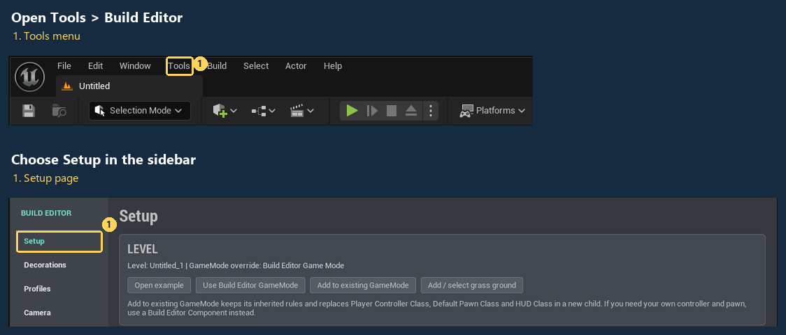

# Build Editor

Build Editor adds in-game building and furnishing to Unreal Engine projects. Players can draw rooms, walls and floors, place doors and windows, connect levels with straight stairs, add roofs, and decorate with furniture.

## Quick Start

Follow the [illustrated Quick Start](DOCUMENTATION.md#quick-start): enable the plugin, connect the supplied controls in **Tools > Build Editor > Setup**, then press **Play** and draw a room. Each step shows the actual editor control and expected result.

The guide uses Unreal Engine 5.4 on Windows 64-bit. The supplied setup works in a Blueprint-only game. A source-only installation needs Unreal's supported C++ build tools.

- [Set up your own level](DOCUMENTATION.md#quick-start)
- [Add building to an existing GameMode](DOCUMENTATION.md#keep-your-existing-gamemode)
- [Add shared multiplayer building](DOCUMENTATION.md#shared-multiplayer-building)
- [Change the camera](DOCUMENTATION.md#change-the-camera)
- [Change the interface and placement controls](DOCUMENTATION.md#customize-the-interface-and-build-interactions)
- [Create your own item catalog](DOCUMENTATION.md#make-a-catalog)
- [Resize windows and doors](DOCUMENTATION.md#resize-windows-and-doors)
- [Mouse, keyboard and gamepad controls](DOCUMENTATION.md#default-controls)
- [Save builds and recover work](DOCUMENTATION.md#schematic-saves)
- [Version notes](CHANGELOG.md)

The included map offers Home and Sci-fi scenes through one scene button. Each scene uses its own catalog, materials, interface theme, camera settings and audio. Use the same profile and scene assets to offer your own building styles.

## Scope

Standalone and shared multiplayer building with grid-aligned walls, straight stairs and rectangular gable roofs. Shared sessions use server-approved edits, personal Undo/Redo and independent player cameras. Your game supplies hosting and joining. Touch, split-screen and cloud storage are outside version 1.0.

## Support

Contact [funbydefault.dev@gmail.com](mailto:funbydefault.dev@gmail.com). Include your plugin and Unreal Engine versions, the steps to reproduce the issue, and the diagnostic message if available.
